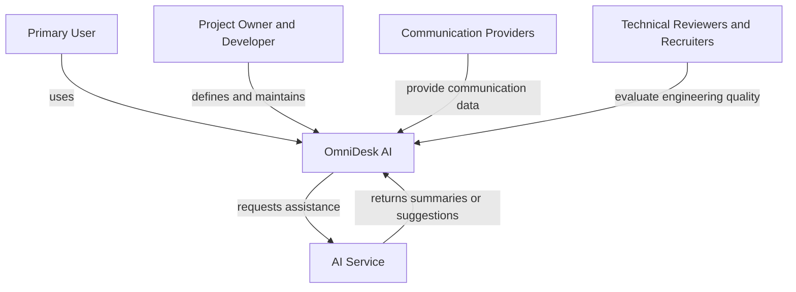

# Project Context Diagram

> Status: Draft

## Purpose

This Mermaid diagram presents OmniDesk AI in its high-level project environment.

## Notes

- The diagram describes the project environment, not the internal architecture.
- Provider-specific implementation details are intentionally excluded.
- AI assistance remains under user control.
