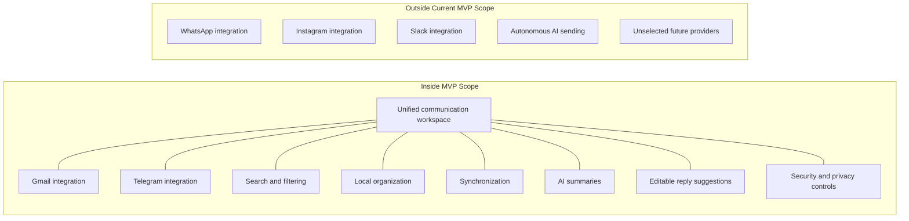

# Project Scope Boundary Diagram

> Status: Draft

## Purpose

This Mermaid diagram visualizes the current MVP boundary of OmniDesk AI.

## Notes

- Items inside the boundary represent the current product direction.
- Items outside the boundary may be considered in future releases.
- Autonomous AI sending is explicitly excluded.
- Final message-sending behavior remains unresolved.
