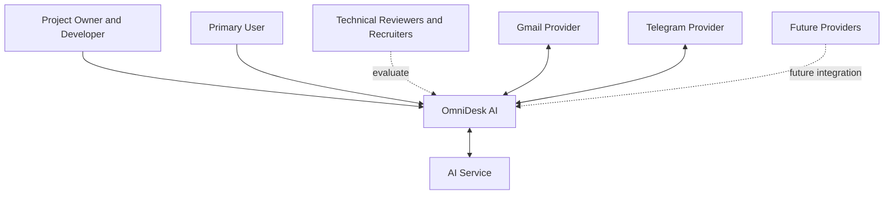

# Stakeholder Ecosystem Diagram

> Status: Draft

## Purpose

This Mermaid diagram shows the main stakeholders, external providers, and supporting services surrounding OmniDesk AI.

## Notes

- The Primary User is the main product stakeholder.
- Gmail and Telegram are the initial providers.
- AI is an assisting external service.
- Future providers are outside the current MVP commitment.
