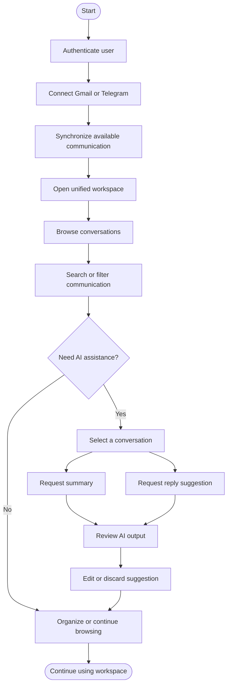

# Main User Workflow Diagram

> Status: Draft

## Purpose

This Mermaid diagram shows the main user workflow for the OmniDesk AI MVP.

## Workflow Rules

- AI assistance is initiated by the user.
- AI output must be reviewed.
- AI failure must not block browsing, searching, or organizing.
- Message sending is not part of this workflow unless separately approved.
