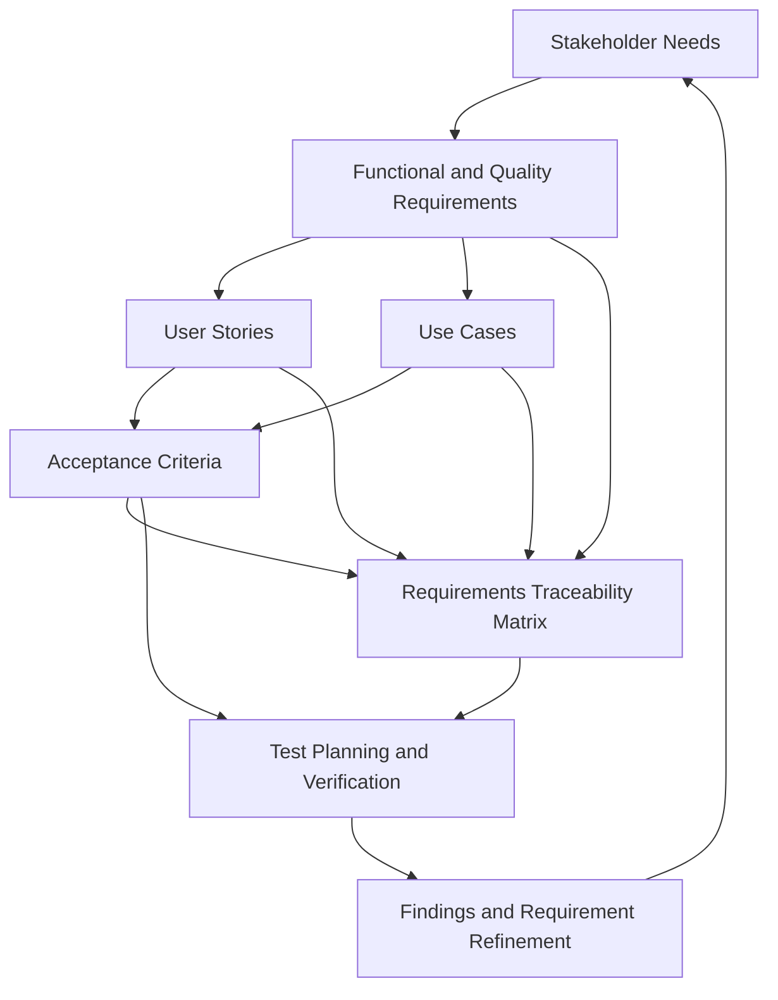

# Requirements Lifecycle Diagram

> Status: Draft

## Purpose

This Mermaid diagram shows how OmniDesk AI requirements move from stakeholder needs to validation.

## Notes

- Requirements may be refined when validation produces new information.
- Traceability connects needs, requirements, behavior, and verification.
- Unresolved product decisions remain explicitly documented.
- This lifecycle supports iterative and incremental development.
