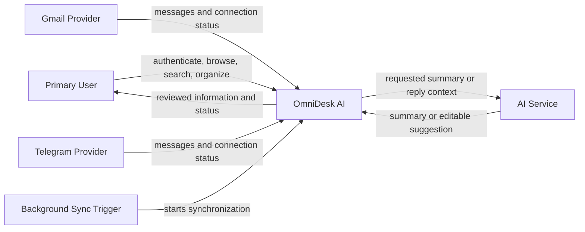

# System Context Diagram

> Status: Draft

## Purpose

This Mermaid diagram defines the system boundary and the main external interactions identified during Requirements Engineering.

## Context Rules

- Gmail and Telegram are the initial external providers.
- AI is an assisting external service, not an autonomous system actor.
- The Background Sync Trigger represents scheduled or system-triggered synchronization.
- The system must not send content autonomously through AI.
