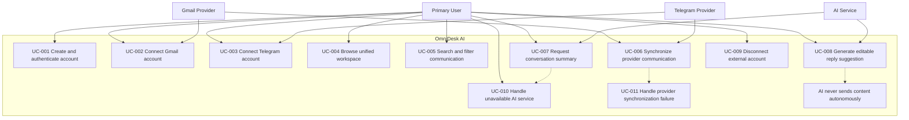

# Use Case Diagram

> Status: Draft

## Purpose

This Mermaid diagram provides a visual overview of the main actors and use cases of OmniDesk AI.

## Diagram Notes

- The Primary User initiates the main workspace and AI interactions.
- Gmail and Telegram are the initial external providers.
- The AI Service supports summaries and editable reply suggestions.
- AI-generated content remains under user control.
- Autonomous AI message sending is explicitly prohibited.
- Provider synchronization failures must not corrupt existing data.

