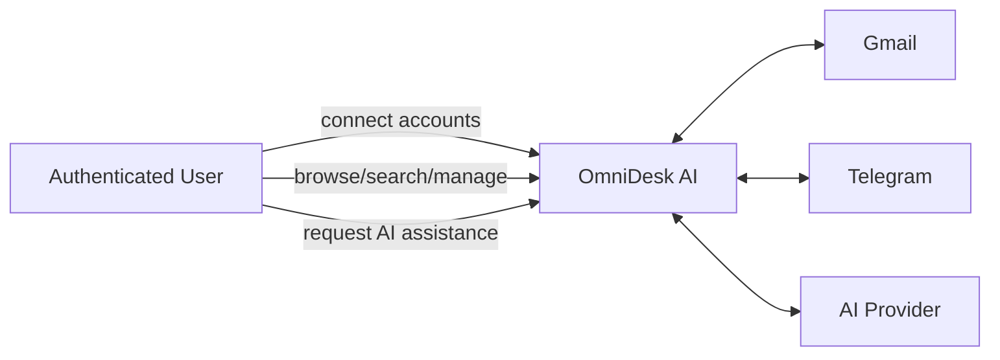
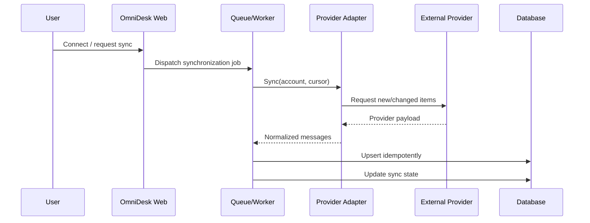

# 3. System Analysis

## System Boundary & Actors

### System Boundary
OmniDesk AI owns the web application, local user/account state, normalized communication model, unified inbox behavior, AI orchestration, synchronization jobs, and local metadata. External providers remain authoritative for their own source data.

### Primary Actor
- Authenticated User

### External Actors / Systems
- Gmail / Google APIs
- Telegram API
- AI Provider API
- Background job/queue infrastructure

## Core Workflows

### WF-01 — Connect External Account
1. User starts a provider connection.
2. Backend initiates the provider authorization flow.
3. User grants permitted access.
4. Backend receives and securely stores required authorization material.
5. Connection status is recorded.
6. Initial synchronization is queued.

### WF-02 — Synchronize Messages
1. A synchronization job starts for a connected provider.
2. Provider adapter requests new or changed source items.
3. Integration layer maps provider-specific data into the internal normalized model.
4. Existing items are matched by provider/external identifiers.
5. New or changed local records are persisted.
6. Synchronization cursor/status is updated.
7. Transient failures are retried according to policy.

### WF-03 — Browse Unified Inbox
1. User opens the inbox.
2. System retrieves normalized communications available to that user.
3. User filters, sorts, searches, or selects a conversation.
4. System presents source metadata while preserving a consistent UI model.

### WF-04 — Generate AI Summary
1. User explicitly requests a summary.
2. System verifies access to the selected content.
3. Relevant text is prepared within configured limits.
4. AI service sends the request through the provider adapter.
5. Result is returned to the user as assistance, not authoritative source data.

### WF-05 — Generate Reply Suggestion
1. User selects a message/conversation and asks for assistance.
2. Backend prepares permitted context.
3. AI provider generates a suggested response.
4. User reviews and may edit the suggestion.
5. Sending requires an explicit user action and the relevant provider capability.

## Domain & Data Analysis

### Core Domain Concepts
- User
- ConnectedAccount
- Provider
- Conversation
- Message
- Participant
- AttachmentMetadata
- Tag / Label
- MessageState
- SyncState
- AIRequest / AIResult metadata

### Normalization Principle
Provider-specific payloads should not leak throughout the application. The system maintains a normalized internal communication model while retaining provider identifiers and selected raw/provider metadata required for traceability and synchronization.

### Key Identity Rule
A source communication item is uniquely correlated using at minimum its provider/account context and external provider identifier. This supports deduplication and idempotent synchronization.

## External System Analysis

### Gmail
- OAuth authorization is required for user mailbox access.
- Integration behavior depends on granted scopes and Google API policies.
- Gmail-specific labels/threads require mapping to OmniDesk's normalized model without pretending all provider concepts are identical.

### Telegram
- Telegram integration capabilities differ depending on whether the system uses bot-oriented or user-account-oriented official APIs.
- The implementation must select and document the supported integration scenario before coding that connector.

### AI Provider
- AI is an assistive subsystem, not the system of record.
- AI failure must not block message browsing or synchronization.
- Generated content must remain reviewable before any external side effect.

## Analysis Diagrams

### Use-Case View

### High-Level Synchronization Sequence

## Analysis Conclusions
- The unified inbox domain must be independent of any single provider.
- Provider adapters require explicit boundaries.
- Synchronization is naturally asynchronous and failure-prone, so idempotency and retry behavior are first-class concerns.
- AI is optional assistance and must remain isolated from critical source-of-truth workflows.
