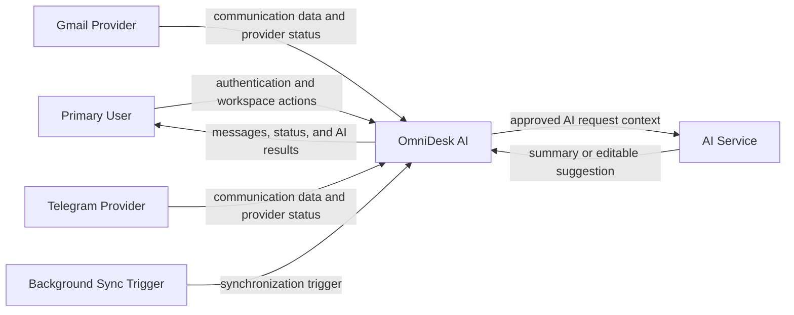

# System Boundary and Context Analysis

> Status: Draft

## Purpose

This document defines the system boundary and external context of OmniDesk AI.

It identifies which responsibilities belong to OmniDesk AI and which responsibilities remain outside the system.

## System Boundary

OmniDesk AI is a provider-agnostic unified communication workspace.

The system is responsible for:

- User authentication and authorization

- Managing provider connections

- Synchronizing supported communication data

- Normalizing provider data

- Displaying a unified workspace

- Searching and organizing communication

- Requesting AI summaries and reply suggestions

- Protecting user data and connection information

- Reporting synchronization and integration status

The system is not responsible for:

- Operating Gmail or Telegram

- Controlling external provider policies

- Training or owning the AI model

- Guaranteeing external provider availability

- Sending messages autonomously

- Implementing future providers in the current MVP

## System Context Diagram

## External Actors and Systems

| External Entity | Relationship with OmniDesk AI |
|---|---|
| Primary User | Uses the workspace and controls user-initiated actions |
| Gmail Provider | Supplies supported Gmail communication data |
| Telegram Provider | Supplies supported Telegram communication data |
| AI Service | Produces user-requested summaries or reply suggestions |
| Background Sync Trigger | Starts scheduled or system-triggered synchronization |

## Context Assumptions

1. The user must authenticate before accessing protected data.
2. Gmail and Telegram are the initial supported providers.
3. External provider data is treated as untrusted input.
4. AI processing occurs only for approved and user-requested features.
5. AI-generated content requires user review.
6. AI must never send content autonomously.
7. Provider failures must not corrupt previously synchronized data.
8. Future providers are outside the current MVP commitment.

## Boundary Decisions

| Decision | Analysis Result |
|---|---|
| Provider ownership | External providers remain responsible for their own accounts and services |
| Communication storage | OmniDesk AI stores only the minimum data required by supported features |
| AI responsibility | AI provides assistance; the user remains responsible for final decisions |
| Synchronization responsibility | OmniDesk AI retrieves, validates, maps, and stores supported data |
| External sending | Remains unresolved and is not part of autonomous AI behavior |
| Future integrations | Must use the provider integration boundary |

## Relationship to Later Analysis

This system boundary will provide input for:

- Domain Model
- Data Flow Diagram
- Synchronization Workflow
- Provider Connection State Diagram
- Sequence Diagrams
- System Design

