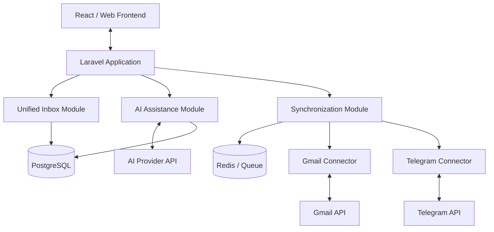
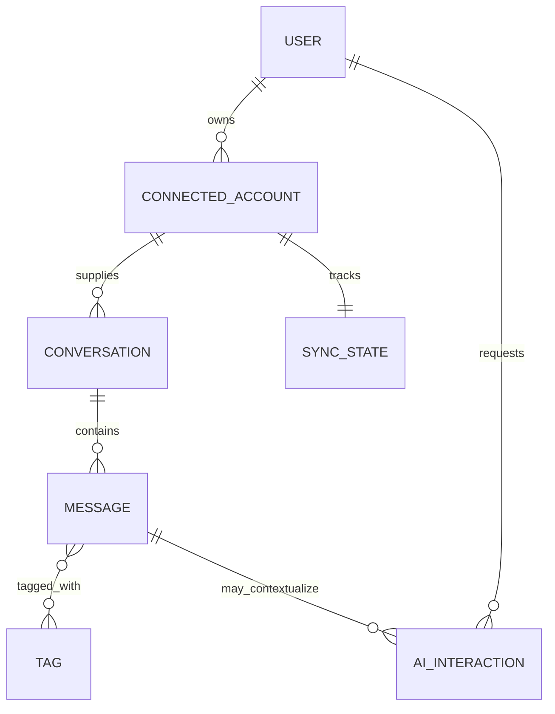
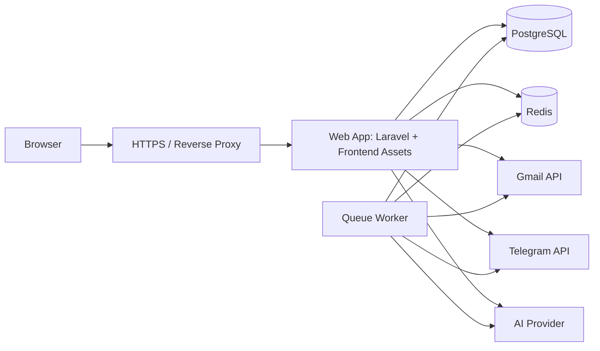

# 4. System Design

> Status: Initial architecture baseline for portfolio/MVP implementation. Decisions may evolve through ADRs as implementation evidence emerges.

## 4.1 Software Architecture

### Architectural Drivers
- Multiple heterogeneous external communication providers.
- Need for secure OAuth/token handling.
- Asynchronous synchronization and retry behavior.
- Clear extensibility for future connectors.
- AI features must be optional and replaceable.
- Portfolio-scale deployment should remain operationally simple.

### Selected System Architecture
**Modular Monolith** is selected for the initial implementation.

Rationale:
- Keeps deployment and local development simple.
- Preserves strong module boundaries without premature distributed-system complexity.
- Supports later extraction of high-load or independent modules if evidence justifies it.

### Application Pattern
The Laravel backend may use **MVC at the HTTP/application boundary**, supplemented by explicit service/application/domain layers where business logic should not live in controllers or Eloquent models.

### Primary Modules
- Identity & Access
- Connections
- Unified Inbox
- Gmail Connector
- Telegram Connector
- AI Assistance
- Synchronization
- Search & Organization
- Audit / Operational Support

### Dependency Direction
Provider-specific modules depend on stable internal contracts; the Unified Inbox must not depend directly on Gmail- or Telegram-specific SDK concepts.

### Integration Pattern
Use adapter/connector abstractions for external providers. Strategy/factory-style selection may be introduced only where implementation requires runtime provider selection.

### Architecture Overview

## 4.2 Database Design

### Database Choice
PostgreSQL is the baseline relational database for durable application state. Redis is reserved for cache/queue/ephemeral coordination rather than primary business data.

### Core Tables / Aggregates
- users
- connected_accounts
- conversations
- conversation_participants
- messages
- message_attachments
- tags
- message_tag
- message_states or equivalent per-user state
- sync_states
- ai_interactions (minimal metadata where useful and privacy-appropriate)
- audit_events (security/operations where justified)

### Key Constraints
- External identity uniqueness must include provider + connected account + external identifier.
- Foreign keys enforce ownership and conversation/message integrity.
- Tokens/secrets are never stored as plaintext application-visible data if secure encryption/storage mechanisms are available.
- Indexes should support inbox ordering, provider filtering, conversation lookup, external-id correlation, and search strategy.

### Conceptual ER View

## 4.3 API & Integration Design

### Internal API Style
RESTful JSON API is the baseline for frontend/backend communication.

### Representative Resources
- `/api/auth/*`
- `/api/connections`
- `/api/conversations`
- `/api/messages`
- `/api/tags`
- `/api/search`
- `/api/ai/summaries`
- `/api/ai/reply-suggestions`
- `/api/sync/*`

Exact endpoints will be finalized during implementation and documented with OpenAPI where practical.

### API Rules
- Consistent validation and structured error responses.
- Pagination for message/conversation collections.
- Filtering/sorting via explicit supported query parameters.
- Authorization checked server-side for every user-owned resource.
- Idempotency considered for synchronization-triggering and provider callback flows.

### External Integration Boundaries
Define internal contracts such as:
- `CommunicationConnector`
- `SyncResult`
- `NormalizedConversation`
- `NormalizedMessage`
- `AIProvider`

Provider SDK objects should be translated at adapter boundaries.

### Synchronization Strategy
- Initial sync after account connection.
- Incremental sync using provider-supported cursors/timestamps/updates where available.
- Background queue workers for network-bound synchronization.
- Bounded exponential retry for transient failures.
- Dead-letter/failure visibility or equivalent operational state for persistent failures.

### Gmail Integration
Use Google OAuth and official Gmail APIs with least-privilege scopes matching implemented features.

### Telegram Integration
Use an officially documented Telegram integration mode selected during implementation. The exact capability set must be validated against the chosen API mode before coding features that assume full personal-account parity.

### AI Integration
Use a backend-only AI provider adapter. Prompts/context assembly, response parsing, provider timeouts, and error handling remain behind the internal AI service boundary.

## 4.4 Security Design

### Authentication & Authorization
- First-party application authentication handled by Laravel-supported mechanisms.
- Every user-owned resource requires authorization checks.
- External account OAuth identities are bound to the authenticated local user.

### OAuth / Token Security
- OAuth state/anti-CSRF protections are required.
- Access/refresh tokens remain backend-only.
- Secrets are encrypted at rest where application storage is required.
- Revocation/disconnection must remove or invalidate locally retained credentials appropriately.

### Web Security Controls
- Server-side input validation.
- CSRF protection where cookie/session authentication is used.
- Output escaping/content handling against XSS.
- ORM/parameterized access to mitigate SQL injection.
- Rate limiting on authentication, AI, and sensitive integration endpoints.
- Secure cookies, TLS, and production security headers.

### AI Safety Boundary
- AI output is untrusted generated content.
- AI suggestions do not trigger external sends without explicit user confirmation.
- Sensitive context sent to the AI provider should be minimized to what the requested feature requires.

### Logging
- Never log access tokens, refresh tokens, API keys, passwords, or complete sensitive provider payloads by default.
- Security-relevant events should be auditable without leaking secrets.

## 4.5 Frontend Design

### Frontend Direction
React with a component-based architecture is the baseline frontend approach. TypeScript is preferred for integration-heavy data contracts.

### Core Screens
- Authentication
- Dashboard
- Unified Inbox
- Conversation Detail
- Connected Accounts / Integrations
- AI Assistance UI
- Search / Filters
- Settings

### UI Principles
- Unified visual treatment while retaining source-platform identity.
- Clear loading, empty, error, stale-sync, and disconnected states.
- AI-generated content visually distinguishable from source messages.
- Responsive design and keyboard-accessible core workflows.

### State Strategy
- Server state should be handled separately from transient UI state.
- API caching/refetch behavior should not become the source of truth for durable communication state.

## 4.6 Detailed & Deployment Design

### Important Detailed-Design Concepts
- Connector interface/adapter boundary.
- Application services for synchronization and AI use cases.
- Thin HTTP controllers.
- Provider-independent domain/data transfer structures.
- Explicit exception categories for authentication, provider limits, transient provider failures, malformed payloads, and authorization failures.

### Candidate Design Patterns
Only patterns justified by code will be implemented/documented:
- Adapter: normalize Gmail/Telegram/AI provider interfaces.
- Strategy: interchangeable provider behavior where runtime selection is needed.
- Factory: connector/provider construction if dependency injection alone is insufficient.
- Observer/Event mechanisms: decouple post-sync or notification behaviors where useful.

### Deployment Baseline
- Containerized development/production-compatible setup.
- Web application container(s).
- PostgreSQL.
- Redis for queues/cache as required.
- Separate queue worker process.
- Reverse proxy/TLS termination in production.
- Environment-based secret configuration.
- CI pipeline for tests/static checks before deployment.

### Deployment View

## Architectural Decisions to Track as ADRs
1. Modular Monolith as initial system architecture.
2. Provider adapter/connector boundary.
3. PostgreSQL as primary durable database.
4. Queue-based asynchronous synchronization.
5. AI as optional assistive subsystem with explicit user confirmation before external side effects.
6. Exact Telegram integration mode after official API capability validation.

## Definition of Ready for Implementation
Phase 4 is ready to transition into implementation when:
- MVP scope and requirements are approved.
- Gmail and Telegram integration capabilities required by the MVP have been validated against official APIs.
- Core data model and connector contracts are stable enough to implement.
- Security boundaries for OAuth/token storage are agreed.
- Initial deployment topology and development environment are chosen.
