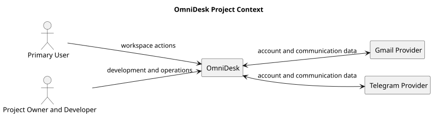

# Project Context Diagram

> Status: Draft

## Purpose

This PlantUML diagram presents OmniDesk in its high-level project environment.

## Diagram

## Notes

- The diagram describes the project environment, not the internal architecture.
- Provider-specific implementation details are intentionally excluded.

## PlantUML Source

The editable PlantUML source is available in [project-context-diagram.puml](./diagrams/project-context-diagram.puml).
