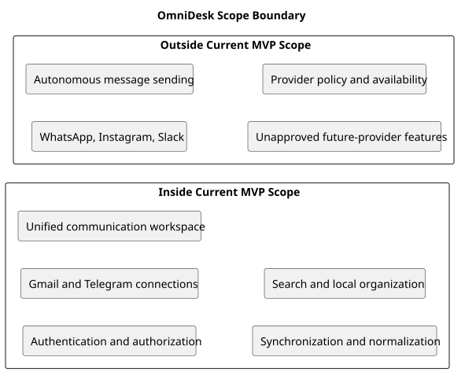

# Project Scope Boundary Diagram

> Status: Draft

## Purpose

This PlantUML diagram visualizes the current MVP boundary of OmniDesk.

## Diagram

## Notes

- Items inside the boundary represent the current product direction.
- Items outside the boundary may be considered in future releases.
- Final message-sending behavior remains unresolved.

## PlantUML Source

The editable PlantUML source is available in [scope-boundary-diagram.puml](./diagrams/scope-boundary-diagram.puml).
