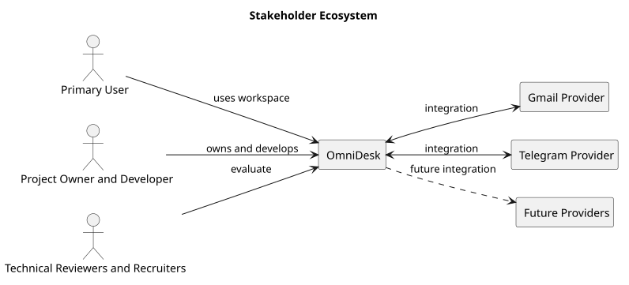

# Stakeholder Ecosystem Diagram

> Status: Draft

## Purpose

This PlantUML diagram shows the main stakeholders, external providers, and supporting services surrounding OmniDesk.

## Diagram

## Notes

- The Primary User is the main product stakeholder.
- Gmail and Telegram are the initial providers.
- Future providers are outside the current MVP commitment.

## PlantUML Source

The editable PlantUML source is available in [stakeholder-ecosystem-diagram.puml](./diagrams/stakeholder-ecosystem-diagram.puml).
