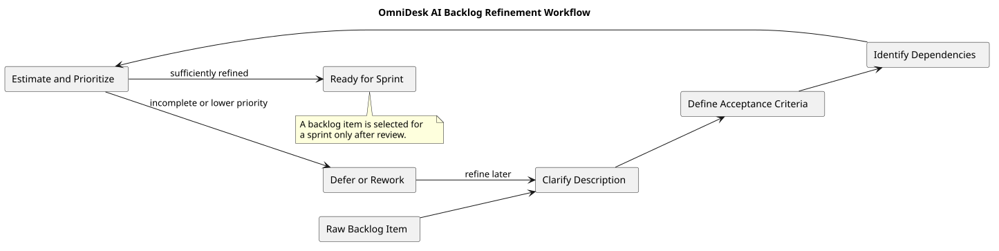

# Backlog Refinement

> Status: Draft

## Purpose

This document describes how OmniDesk AI backlog items are prepared before sprint planning.

## Workflow

## Refinement Activities

Each backlog item should be reviewed to determine:

- What capability or work is required.

- Which milestone it supports.

- Its priority.

- Its acceptance criteria.

- Its dependencies.

- Its implementation tasks.

- Its testing requirements.

- Whether it is ready for sprint selection.

## Readiness Rule

A backlog item is ready for sprint planning when:

- Its purpose is clear.

- Its scope is understandable.

- Acceptance criteria are defined.

- Dependencies are identified.

- Priority is known.

- The item can be divided into implementation tasks.

- Relevant testing is understood.

## Deferral Rule

An item may be deferred or returned for further refinement when:

- Its scope is unclear.

- Acceptance criteria are missing.

- A dependency is unresolved.

- Required provider capabilities are not validated.

- Its priority is lower than the current sprint capacity.

- It is outside the approved project scope.

## Relationship to Sprints

Backlog refinement prepares items for sprint planning.

Sprint planning selects a limited set of ready backlog items.

A backlog item is not committed to a sprint until it has been reviewed and selected.

## PlantUML Source

The editable source is available in [backlog-refinement.puml](./diagrams/backlog-refinement.puml).
