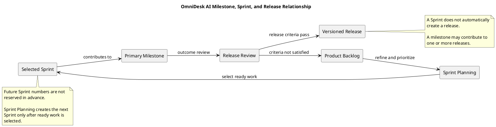

# Milestone, Sprint, and Release Relationship

> Status: Approved
> Normalized: 2026-09-14
> Agile allocation corrected: 2026-09-18
> Diagram source: PlantUML

## Purpose

This document explains how product backlog items, sprints, milestones, and releases relate to one another in OmniDesk AI.

## Diagram

The authoritative diagram source is PlantUML:



The editable source file is [milestone-sprint-release-relationship.puml](./diagrams/milestone-sprint-release-relationship.puml).

The diagram is intentionally generic. Future Sprint numbers are not reserved in advance; Sprint Planning creates the next Sprint only after backlog items are refined, prioritized, and selected.

## Relationship Model

- The product backlog contains planned work items.
- Sprint Planning selects a limited set of ready backlog items.
- A Sprint produces a reviewable implementation increment.
- Multiple Sprints may contribute to one milestone.
- Each Sprint has exactly one primary milestone.
- Milestones represent meaningful project outcomes.
- Releases represent published increments.
- A Sprint does not automatically create a release.
- A milestone does not automatically equal one version.
- A release is created only after release criteria are satisfied.
- Future Sprint numbers and assignments are created only during Sprint Planning.

## Current Allocation

Completed historical Sprint allocations are recorded below. Future milestone work remains unassigned until Sprint Planning.

| Milestone | Contributing Sprints | Outcome |
|---|---|---|
| M0 | Sprint 00 and Sprint 01 | Engineering foundation |
| M1 | Sprint 02 and Sprint 03 | Authentication and workspace foundation |
| M2 | Sprint 04 and Sprint 05 | Gmail connection and synchronization |
| M3 | Sprint 06 | Unified communication workspace |
| M4 | TBD through Sprint Planning | Telegram connection and synchronization |
| M5 | TBD through Sprint Planning | User-controlled AI assistance |
| M6 | TBD through Sprint Planning | Production hardening and release readiness |

This allocation is consistent with the approved milestone governance: M4, M5, and M6 do not reserve Sprint 07, Sprint 08, or Sprint 09 in advance.

## Sprint Assignment Rule

Before future work is assigned to a Sprint:

1. Relevant backlog items are refined.
2. Dependencies and unresolved decisions are reviewed.
3. Priority is compared with other ready work.
4. Sprint Planning selects a limited scope.
5. Only then is a Sprint number, Sprint Goal, and primary milestone recorded.

Refinement alone does not commit an item to the next Sprint.

## Release Rule

A release may include work from one or more milestones.

A version tag is created only after:

- The intended milestone outcomes are complete.
- Acceptance criteria are satisfied.
- Required tests pass.
- Security checks pass.
- Release-blocking defects are resolved.
- Release notes are prepared.

The project uses Semantic Versioning:

```text
MAJOR.MINOR.PATCH
```

## PlantUML Source

The editable PlantUML source is available in [milestone-sprint-release-relationship.puml](./diagrams/milestone-sprint-release-relationship.puml).

PlantUML is the source of truth for this diagram. Generated visual files, when included, must be regenerated from this `.puml` source rather than edited independently.
