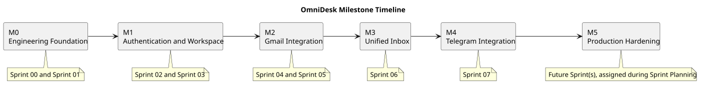

# Milestone Timeline

> Status: Approved
> Normalized: 2026-09-14

## Purpose

This document presents the planned progression of OmniDesk AI milestones.

## Timeline

## Milestones

| Order | Milestone | Contributing Sprints | Main Outcome |
|---|---|---|---|
| 1 | M0 - Engineering Foundation | Sprint 00 and Sprint 01 | Reliable development foundation |
| 2 | M1 - Authentication and Workspace | Sprint 02 and Sprint 03 | Secure communication workspace |
| 3 | M2 - Gmail Integration | Sprint 04 and Sprint 05 | Gmail connection and synchronization |
| 4 | M3 - Unified Inbox | Sprint 06 | Unified communication workspace |
| 5 | M4 - Telegram Integration | Sprint 07 | Telegram connection and synchronization |
| 6 | M5 - AI-Assisted Communication | Sprint 08 | User-controlled AI assistance |
| 7 | M6 - Production Hardening | Sprint 09 | Release readiness |

## Important Planning Rule

The timeline is a planning baseline, not a fixed schedule.

Milestones may be divided, extended, reordered, or supported by additional sprints when implementation evidence requires it.

## Release Relationship

Milestone completion does not automatically create a release.

A release requires:

- Completed milestone outcomes.
- Satisfied acceptance criteria.
- Passing tests.
- Security verification.
- Resolved release-blocking defects.
- Prepared release notes.

## PlantUML Source

The editable source is available in [milestone-timeline.puml](./diagrams/milestone-timeline.puml).
