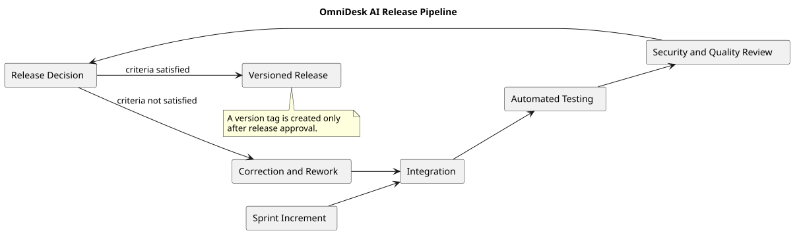

# Release Pipeline


> Status: Draft


## Purpose


This document describes how a reviewable sprint increment becomes a versioned release in OmniDesk AI.


## Pipeline





## Release Stages


1. Sprint increment is completed.

2. Changes are integrated.

3. Automated tests are executed.

4. Security and quality checks are performed.

5. Release criteria are reviewed.

6. The release decision is made.

7. A versioned release is created if the criteria are satisfied.


## Release Criteria


A release may proceed when:


- Intended milestone outcomes are complete.

- Acceptance criteria are satisfied.

- Required automated tests pass.

- Security checks pass.

- Release-blocking defects are resolved.

- Documentation is updated.

- Release notes are prepared.

- Deployment and recovery requirements are understood.


## Rework Rule


If release criteria are not satisfied:


- The release is not created.

- The incomplete work returns for correction.

- Additional implementation or testing may be planned.

- The release review is repeated later.


## Versioning


The project uses Semantic Versioning:


```text

MAJOR.MINOR.PATCH
```

## PlantUML Source

The editable source is available in [release-pipeline.puml](./diagrams/release-pipeline.puml).
