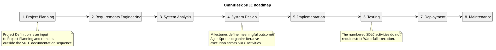

# SDLC Roadmap

> Status: Draft

## Purpose

This document describes the Software Development Life Cycle structure used by OmniDesk AI.

Project Definition is maintained separately under `docs/Project-Definition/`. It defines the project's problem, goals, scope, stakeholders, assumptions, risks, and success criteria. It is an input to the SDLC, not an SDLC phase.

## Roadmap

## SDLC Phases

| Phase | Main Responsibility |
|---|---|
| Project Planning | Formally initiate development execution using the approved project definition, delivery model, backlog, milestones, sprint process, risks, constraints, and initial technical direction |
| Requirements Engineering | Elicit, document, validate, and manage requirements |
| System Analysis | Analyze behavior, domain concepts, workflows, and business rules |
| System Design | Define architecture, modules, APIs, data, security, and deployment structure |
| Implementation | Build the backend, frontend, integrations, and supporting components |
| Testing | Verify functionality, security, reliability, performance, and quality |
| Deployment | Prepare and operate the application in its target environment |
| Maintenance | Correct defects, support released versions, improve the system, and evolve capabilities in a controlled way |

## Project Definition Relationship

Project Definition remains outside the SDLC at `docs/Project-Definition/`.

Project Planning consumes those approved definition artifacts and organizes execution. It does not redefine project scope, goals, stakeholders, or product identity.

## Agile Execution

Agile milestones and sprints organize the practical execution of the SDLC.

- Milestones represent meaningful outcomes.
- Sprints are short execution cycles.
- Backlog items are selected for sprints.
- Sprint increments are reviewed against acceptance criteria.
- Releases are created after release criteria are satisfied.

## Current Project Structure

The SDLC documentation folders are:

- `01-project-planning`
- `02-requirements-engineering`
- `03-system-analysis`
- `04-system-design`
- `05-implementation`
- `06-testing`
- `07-deployment`
- `08-maintenance`

Project Definition remains separately maintained under `docs/Project-Definition/`.

## PlantUML Source

The editable source is available in [sdlc-roadmap.puml](./diagrams/sdlc-roadmap.puml).
