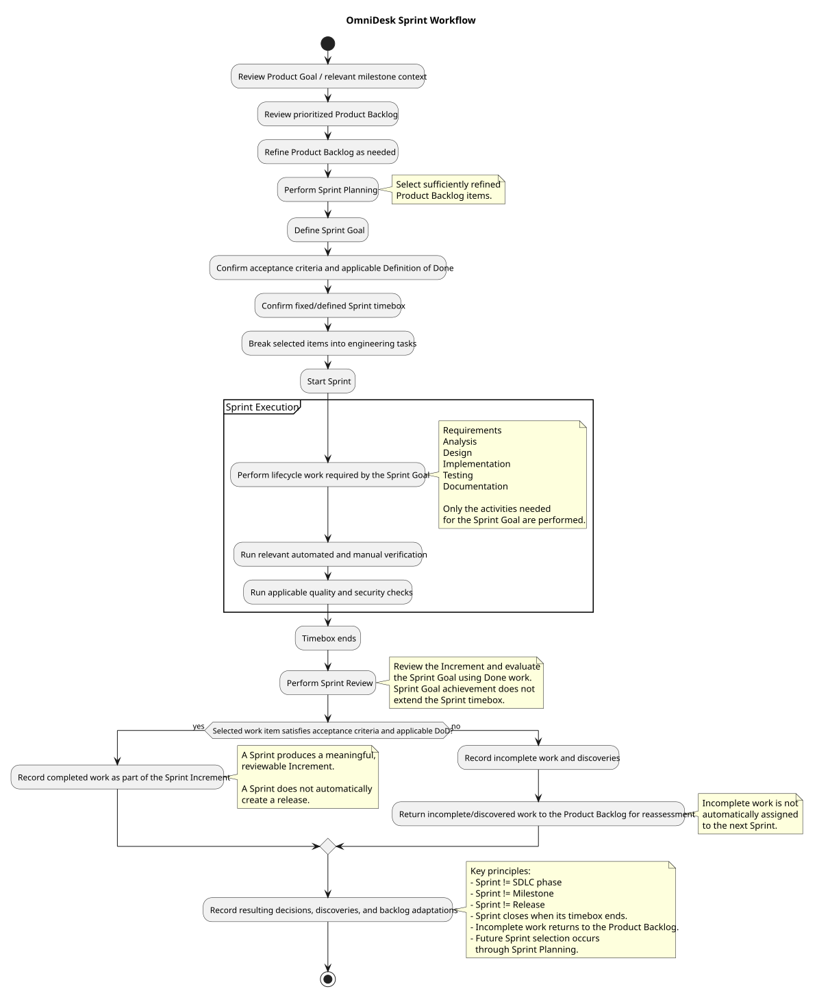

# Sprint Workflow

> Status: Draft

## Purpose

This document describes the standard workflow used to plan, execute, verify, and complete an OmniDesk AI Sprint.

A Sprint is an execution iteration, not an SDLC phase. Depending on the Sprint Goal, it may involve Requirements, Analysis, Design, Implementation, Testing, and Documentation activities as needed.

## Workflow

The editable workflow source is [sprint-workflow.puml](./diagrams/sprint-workflow.puml).

## Sprint Activities

1. Review the relevant milestone outcome.
2. Refine the Product Backlog as needed.
3. Select backlog items for the Sprint.
4. Define the Sprint Goal.
5. Confirm or define acceptance criteria.
6. Break selected items into engineering tasks.
7. Perform the lifecycle work required by the Sprint Goal, such as requirements refinement, analysis, design, implementation, testing, or documentation.
8. Run relevant automated and manual verification.
9. Run applicable quality and security checks.
10. Review the Sprint Increment against the Sprint Goal and acceptance criteria.
11. Record completed and incomplete work and any resulting decisions or discoveries.

A Sprint is not required to mechanically execute every SDLC activity. The necessary engineering activities are selected according to the Sprint Goal and the work being delivered.

## Completion Rule

A Sprint is complete when:

- Its Sprint Goal is achieved.
- Acceptance criteria for completed work are satisfied.
- Relevant tests and verification pass.
- Applicable quality and security checks pass.
- Required documentation is updated.
- The Increment is reviewable.
- Completed and incomplete work is recorded.

## Review and Adaptation

Sprint review, feedback, technical discoveries, and changing priorities may refine or reprioritize future Product Backlog items. Incomplete work returns to the appropriate backlog or future Sprint rather than being treated as complete.

## Release Relationship

A Sprint produces a meaningful, reviewable Increment.

A Sprint does not automatically create a release. A release requires a separate assessment of release criteria and the intended product state.

## PlantUML Source

The editable source is available in [sprint-workflow.puml](./diagrams/sprint-workflow.puml).
