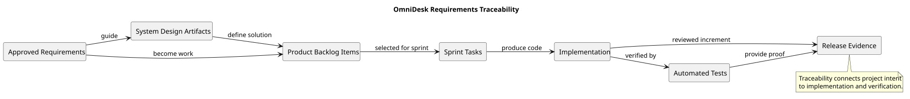

# Requirements Traceability

> Status: Draft

## Purpose

This document describes how OmniDesk maintains traceability from approved requirements to design, implementation, testing, and release evidence.

## Traceability Diagram

## Traceability Chain

| Source | Leads To | Purpose |
|---|---|---|
| Approved Requirements | System Design Artifacts | Define the technical response |
| Approved Requirements | Product Backlog Items | Convert needs into planned work |
| System Design Artifacts | Product Backlog Items | Define implementation boundaries |
| Product Backlog Items | Sprint Tasks | Select work for execution |
| Sprint Tasks | Implementation | Produce the software change |
| Implementation | Automated Tests | Verify behavior and quality |
| Automated Tests | Release Evidence | Demonstrate completion |
| Implementation | Release Evidence | Provide the reviewed increment |

## Traceability Expectations

Each selected backlog item should identify:

- The related requirement.
- The related milestone.
- The related sprint.
- The relevant design artifact.
- The implementation tasks.
- The acceptance criteria.
- The relevant automated tests.
- The completion evidence.

## Security Risk Traceability Status

The authoritative risk identifiers come from the SEC-001 threat model. The table below records the current state of the downstream chain without treating planned work as implemented.

| Risk | Security Requirement(s) | Backlog Control | Design / Implementation / Test State |
|---|---|---|---|
| RISK-001 | SPR-003, SPR-010 | SEC-003, SEC-010 | Bearer token in `sessionStorage` is implemented; HTML isolation/sanitization exists; session hardening and focused security verification remain pending |
| RISK-002 | SPR-021 | SEC-004 | Email OTP two-step verification is V1 Required and Planned; implementation/tests pending |
| RISK-003 | SPR-022 | SEC-005 | Recovery/password lifecycle is V1 Required and Planned; detailed implementation/tests pending |
| RISK-004 | SPR-023 | SEC-006 | Sensitive-action reauthentication is Planned; design/implementation/tests pending |
| RISK-005 | SPR-002, SPR-008 | SEC-007 | Ownership scoping and regression tests exist for current resources; broader regression matrix remains Planned |
| RISK-006 | SPR-005 | SEC-008 | Gmail token encryption/hidden serialization are implemented and tested; production key lifecycle remains Planned |
| RISK-007 | SPR-006, IR-004 | SEC-009 | Current Gmail scopes are configured; formal feature-to-scope least-privilege review remains Planned |
| RISK-008 | SPR-010 | SEC-010 | Current frontend sanitization/isolation exists; systematic security verification remains Planned |
| RISK-009 | SPR-010, privacy principles | SEC-011 | Remote-content privacy control remains Planned; current HTML policy does not constitute completion |
| RISK-010 | SPR-020 | SEC-012 | Login/registration throttling exists; broader sensitive-endpoint abuse controls remain Planned |
| RISK-011 | SPR-012 | SEC-013 | Log-content prohibitions exist; formal audit trail/redaction baseline remains Planned |
| RISK-012 | SPR-018 | SEC-014 | Secure transport is required by design; production TLS/header evidence remains a deployment gate |
| RISK-013 | SPR-024 | SEC-015 | Production database/Redis/storage hardening and persisted-message protection decision remain Planned |
| RISK-014 | SPR-025 | SEC-016 | Backup encryption/access/retention/restore evidence remains a deployment gate |
| RISK-015 | SPR-019, SPR-020 | SEC-017 | CI tests/lint/build exist; dedicated security CI/CD controls remain Planned |
| RISK-016 | SPR-016, SPR-017, NFR-004, NFR-006 | SEC-018 | SEC-002 lifecycle baseline exists; GDPR/privacy engineering implementation remains Planned |
| RISK-017 | SPR-005, IR-005 | SEC-019 | TDLib architecture direction exists; Telegram credential/session security gate remains Planned before PB-024 |
| RISK-019 | NFR-019 | SEC-021 | Monitoring/incident-response baseline remains Planned; release/operational evidence pending |

Release and deployment evidence must remain explicitly pending until the relevant security control and environment actually exist.

## Completion Rule

Work is not considered complete only because code exists.

Completion requires the applicable requirements, acceptance criteria, tests, security checks, and review evidence.

## PlantUML Source

The editable source is available in [traceability.puml](./diagrams/traceability.puml).
