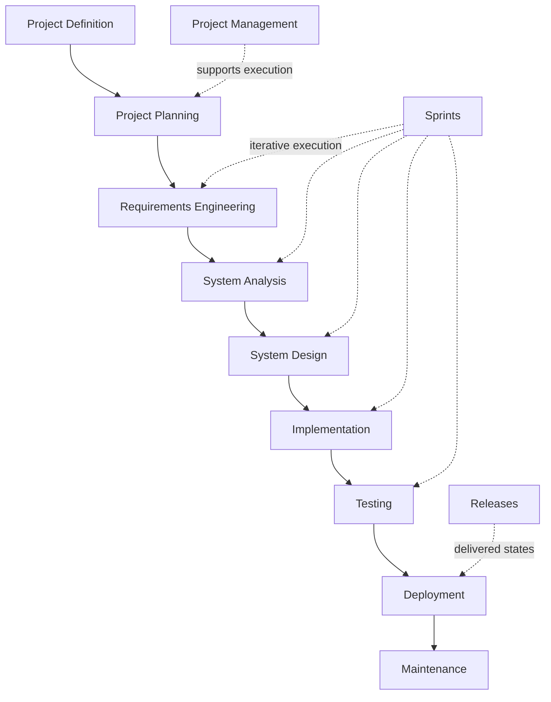

# OmniDesk AI Documentation Map

This directory organizes the engineering documentation for Web-OmniDesk-AI.

The structure is a project-specific information architecture. It is not intended to represent a mandatory industry-standard folder layout.

## Start Here

The numbered SDLC documentation areas organize engineering activities and artifacts. They do **not** require strict sequential Waterfall execution. Web-OmniDesk-AI executes work iteratively and incrementally through Agile practices and lightweight Scrum-style Sprints.

## Documentation Areas

### [Project Definition](./Project-Definition/)

Defines what OmniDesk AI is, why it exists, its goals, V1 scope, stakeholders, assumptions, constraints, risks, and success criteria.

Project Definition remains outside the numbered SDLC documentation sequence and provides foundational input to Project Planning.

### [SDLC](./SDLC/)

Organizes lifecycle-oriented engineering documentation:

1. Project Planning
2. Requirements Engineering
3. System Analysis
4. System Design
5. Implementation
6. Testing
7. Deployment
8. Maintenance

These folders describe engineering responsibilities and artifacts rather than a strict execution sequence.

### [Project Management](./Project-Management/)

Contains living execution-management artifacts such as the Product Backlog, roadmap, milestones, backlog refinement, release planning relationships, and delivery workflows.

This area is the source of truth for project-management artifacts rather than duplicating them inside SDLC phase documentation.

### [Sprints](./Sprints/)

Contains Sprint-specific execution records. A Sprint is a short iteration with a Sprint Goal and a meaningful Increment. Depending on the goal, a Sprint may include Requirements, Analysis, Design, Implementation, Testing, and Documentation work as needed.

A Sprint is not an SDLC phase and does not automatically create a release.

### [Releases](./Releases/)

Contains release-oriented documentation for actual or prepared software states. Release documentation is distinct from Sprint history, milestones, and roadmap planning.

## Core Distinctions

- **SDLC**: lifecycle and engineering structure
- **Agile / Scrum-style execution**: how work is organized and adapted over time
- **Knowledge Areas**: engineering disciplines applied where relevant
- **Cross-Cutting Concerns**: concerns such as security, privacy, quality, performance, reliability, maintainability, accessibility, and documentation that affect multiple engineering activities
- **Sprint**: short execution iteration
- **Milestone**: significant outcome or checkpoint
- **Increment**: meaningful result produced through a Sprint
- **Release**: software state prepared or published according to release criteria
- **Version**: identifier assigned to a software state according to the versioning strategy

## V1 Scope Protection

The current V1 baseline includes Gmail and Telegram as communication providers. Additional providers or advanced capabilities remain outside V1 unless the Project Definition and related authoritative planning documents are explicitly changed.
