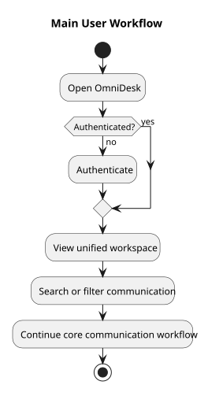

# Main User Workflow Diagram

> Status: Draft

## Purpose

This PlantUML activity diagram shows the main user workflow for the OmniDesk MVP.

## Diagram

## Notes

- Message sending is not part of this workflow unless separately approved.

## PlantUML Source

The editable PlantUML source is available in [main-user-workflow-diagram.puml](./diagrams/main-user-workflow-diagram.puml).
