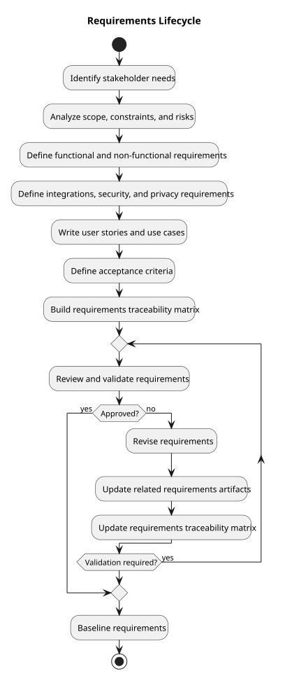

# Requirements Lifecycle Diagram

> Status: Draft

## Purpose

This PlantUML activity diagram shows how OmniDesk requirements move from stakeholder needs to validation.

## Diagram

## Notes

- Requirements may be refined when validation produces new information.
- Revisions update related artifacts and the traceability matrix before validation repeats.
- Unresolved product decisions remain explicitly documented.
- This lifecycle supports iterative and incremental development.

## PlantUML Source

The editable PlantUML source is available in [requirements-lifecycle-diagram.puml](./diagrams/requirements-lifecycle-diagram.puml).
