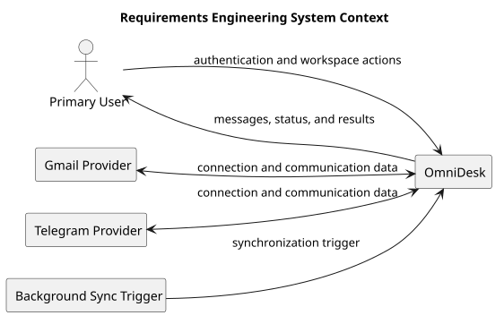

# System Context Diagram

> Status: Draft

## Purpose

This PlantUML diagram defines the system boundary and the main external interactions identified during Requirements Engineering.

## Diagram

## Notes

- Gmail and Telegram are the initial external providers.
- The Background Sync Trigger represents scheduled or system-triggered synchronization.

## PlantUML Source

The editable PlantUML source is available in [system-context-diagram.puml](./diagrams/system-context-diagram.puml).
