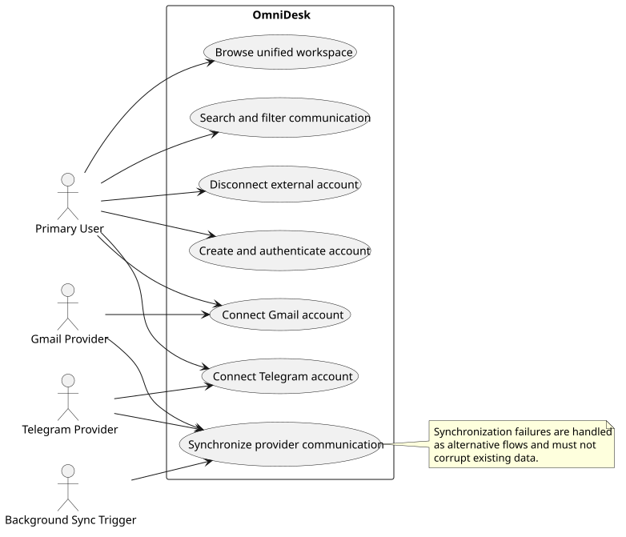

# Use Case Diagram

> Status: Draft

## Purpose

This document presents the UML-style Use Case Diagram for OmniDesk.

The diagram is authored in PlantUML and displayed in this Markdown file as an SVG image.

## Diagram

## Diagram Notes

- Primary User is the main human actor.
- Gmail Provider and Telegram Provider are external communication systems.
- Background Sync Trigger represents scheduled or system-triggered synchronization.
- Message sending remains outside the current MVP commitment.

## Source

The editable PlantUML source is available in [use-case-diagram.puml](./diagrams/use-case-diagram.puml).
