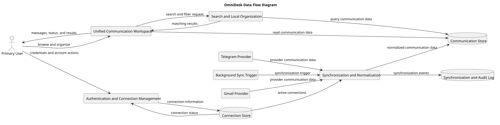

# Data Flow Diagram

> Status: Draft

## Purpose

This diagram shows how data enters, moves through, and leaves OmniDesk.

It focuses on system responsibilities and data movement without defining database tables or implementation details.

## Diagram

## Main Data Flows

- Users provide authentication and workspace actions.

- Gmail and Telegram provide external communication data.

- Synchronization normalizes provider data before storage.

- The workspace reads normalized communication data.

- Search queries the local communication store.

- Synchronization events are recorded without sensitive content.

## Analysis Notes

- The Communication Store represents provider-independent local data.

- The Connection Store contains protected connection information.

- The Synchronization and Audit Log must not expose credentials, tokens, or unnecessary message content.

- This diagram is conceptual and does not define database schema.

## PlantUML Source

The editable PlantUML source is available in [data-flow-diagram.puml](./diagrams/data-flow-diagram.puml).

