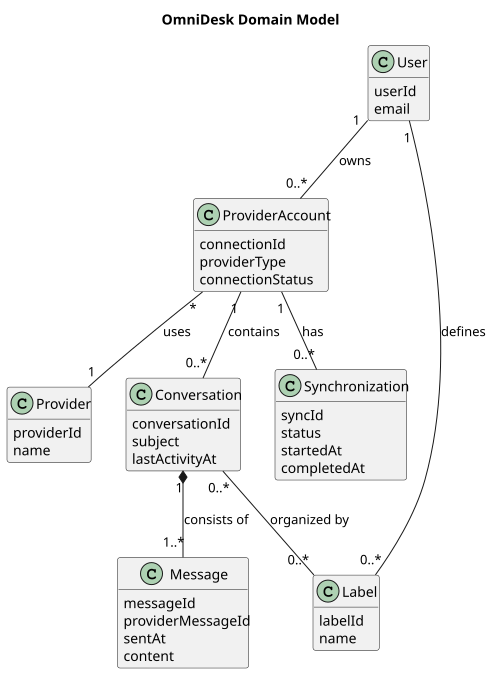

# Domain Model

> Status: Draft

## Purpose

This conceptual domain model identifies the main business concepts and relationships within OmniDesk.

It describes the communication domain without defining database tables or implementation classes.

## Diagram

## Domain Concepts

- `User` owns provider connections and local labels.

- `ProviderAccount` represents a connected Gmail or Telegram account.

- `Provider` identifies the external communication provider.

- `Conversation` groups related messages.

- `Message` represents synchronized communication content.

- `Label` represents local organization metadata.

- `Synchronization` records synchronization activity and status.

## Analysis Notes

- This is a conceptual model, not a database schema.

- Provider-specific data is mapped to provider-independent concepts.

- Message sending is not represented as an approved capability.

- Security and privacy constraints apply to every concept.

## PlantUML Source

The editable PlantUML source is available in [domain-model.puml](./diagrams/domain-model.puml).

