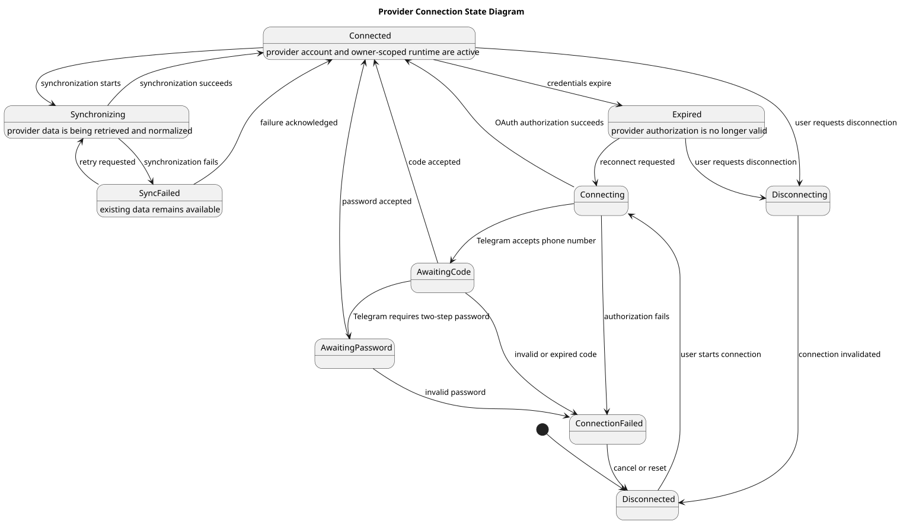

# Provider Connection State Diagram

> Status: Draft

## Purpose

This state diagram describes the lifecycle of a Gmail or Telegram provider connection.

## Diagram

## Main States

- `Disconnected`: No active provider connection exists.

- `Connecting`: Authorization is in progress.

- `Connected`: The provider account is active.

- `Synchronizing`: Provider data is being retrieved and normalized.

- `SyncFailed`: Synchronization failed, but existing data remains available.

- `Expired`: Provider authorization is no longer valid.

- `Disconnecting`: The connection is being invalidated.

## State Rules

- Authorization failure returns the connection to `Disconnected`.

- Synchronization failure must not corrupt existing data.

- A failed synchronization may be retried.

- Expired connections require reauthorization.

- Disconnecting a provider invalidates its connection information.

## PlantUML Source

The editable PlantUML source is available in [provider-connection-state-diagram.puml](./diagrams/provider-connection-state-diagram.puml).

