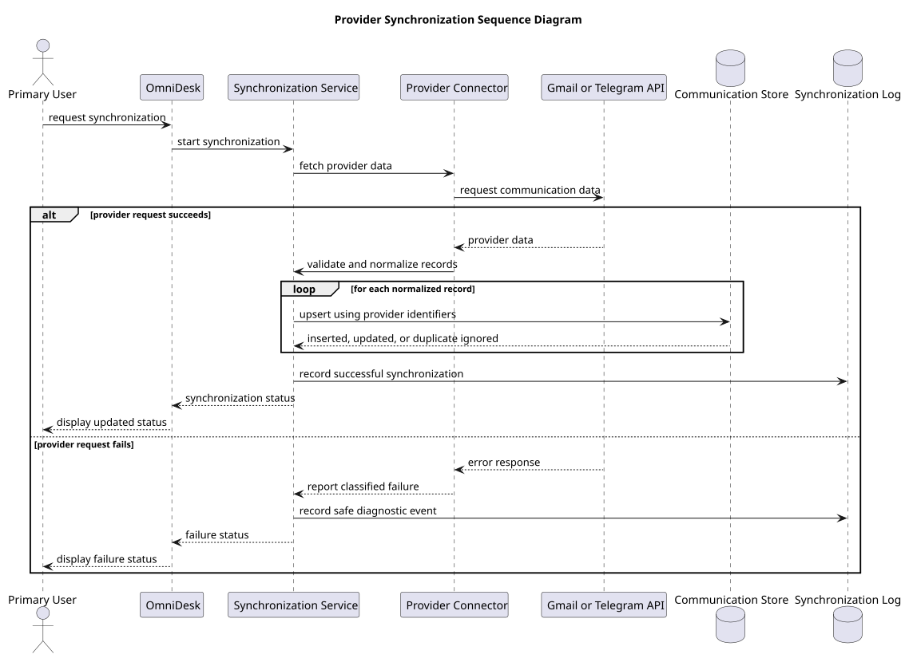

# Provider Synchronization Sequence Diagram

> Status: Draft

## Purpose

This sequence diagram shows the interaction between the user, OmniDesk, provider connectors, external providers, storage, and synchronization logging.

## Diagram

## Interaction Rules

- Synchronization may be initiated by the user.

- Provider data must be validated and normalized.

- Records must use provider identifiers for duplicate prevention.

- Existing data remains available when synchronization fails.

- Diagnostic logs must not expose sensitive information.

- Synchronization status must be reported to the user.

## PlantUML Source

The editable PlantUML source is available in [provider-synchronization-sequence-diagram.puml](./diagrams/provider-synchronization-sequence-diagram.puml).

