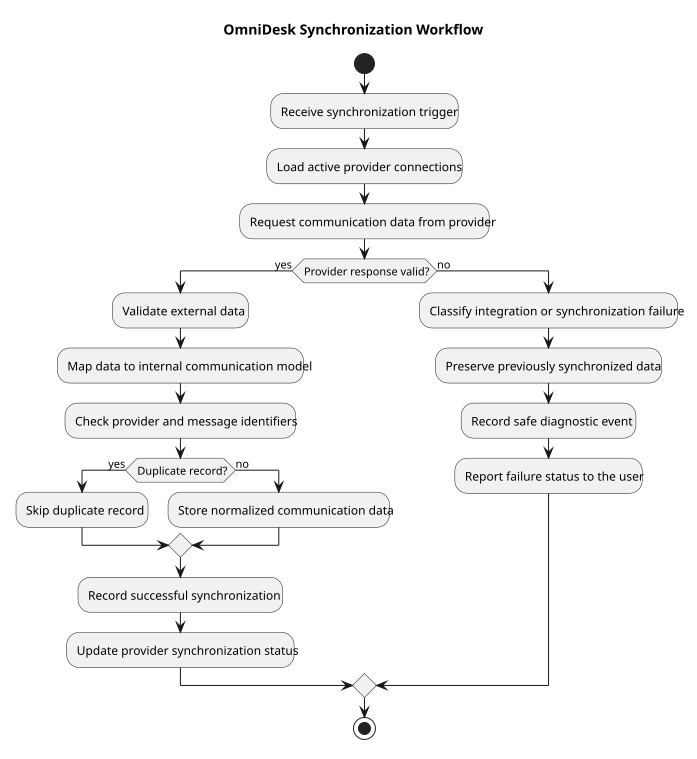

# Synchronization Workflow

> Status: Draft

## Purpose

This activity diagram describes how OmniDesk synchronizes communication data from external providers.

## Diagram

## Workflow Rules

- External provider data is treated as untrusted input.

- Provider data is validated before normalization.

- Provider-specific identifiers support duplicate prevention.

- Previously synchronized data is preserved when synchronization fails.

- Failures are recorded without exposing sensitive information.

- Synchronization status is communicated to the user.

## PlantUML Source

The editable PlantUML source is available in [synchronization-workflow.puml](./diagrams/synchronization-workflow.puml).

