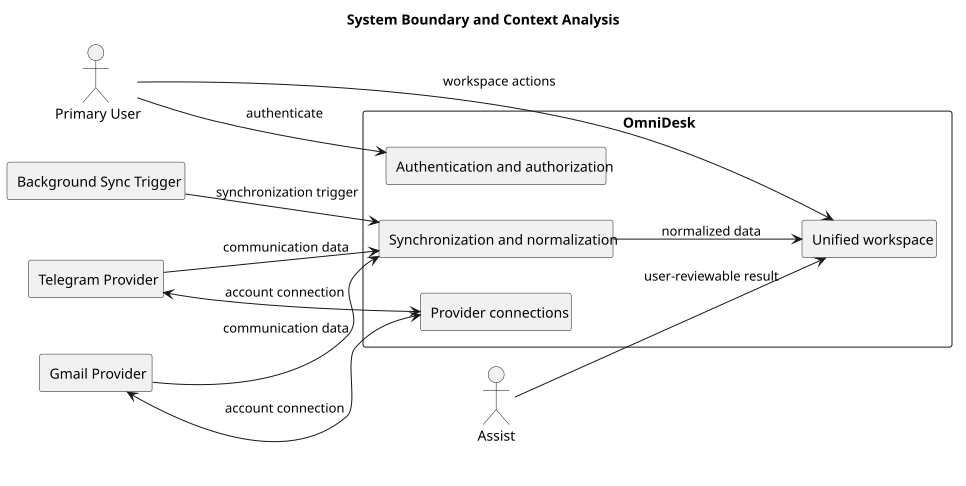

# System Boundary and Context Analysis

> Status: Draft

## Purpose

This document defines the system boundary and external context of OmniDesk.

## Diagram

## Notes

- Provider data is normalized before it reaches the unified workspace.

## PlantUML Source

The editable PlantUML source is available in [system-boundary-and-context-analysis.puml](./diagrams/system-boundary-and-context-analysis.puml).
