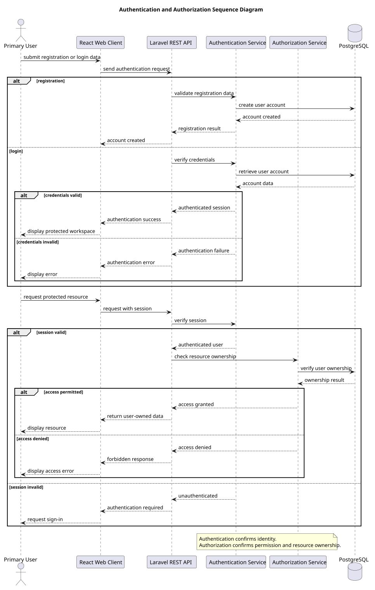

# Authentication and Authorization Design

> Status: Draft

## Purpose

This document defines the initial authentication and authorization design for OmniDesk.

Authentication verifies the identity of a user. Authorization verifies whether the authenticated user is allowed to access a resource.

## Design Objectives
- Protect user accounts and communication data.
- Require authentication before accessing protected resources.
- Ensure users can access only their own data.
- Keep credentials and provider tokens protected on the backend.
- Support secure authentication-token management.
- Provide clear authentication and authorization failures.
- Keep authentication and authorization independently testable.

## Authentication Scope

Authentication covers:
- User registration
- User login
- Credential verification
- Bearer-token issuance
- Bearer-token validation
- Bearer-token revocation during logout
- Access to the authenticated user identity

## Authorization Scope

Authorization covers:
- Resource ownership checks
- Access to user-owned conversations
- Access to provider connections
- Access to synchronization records
- Access to local labels and tags
- Denial of unauthorized requests

## Authentication Sequence Diagram



> Note: the legacy sequence diagram uses the word "session" generically. The current V1 web client authenticates API requests with Laravel Sanctum personal access bearer tokens as described below.

## Authentication Rules
- Registration data must be validated.
- Passwords must never be stored in plain text.
- Login must verify the submitted credentials.
- A successful registration or login issues a Laravel Sanctum bearer token.
- Invalid credentials must not reveal unnecessary account information.
- Logout must revoke the current bearer token.
- Invalid or expired bearer tokens must be rejected.
- Authentication errors must not expose sensitive details.

## Authorization Rules
- Every protected request must identify the authenticated user.
- Every user-owned resource must be checked for ownership.
- A user must not access another user's conversations.
- A user must not access another user's provider connections.
- A user must not access another user's synchronization records.
- Unauthorized access must return a forbidden response.
- Missing authentication must return an authentication-required response.

## Credential and Authentication-Token Protection
- Passwords must be securely hashed.
- Credentials must be transmitted only over protected connections.
- The V1 web client stores its bearer token in `sessionStorage`, not `localStorage`.
- Sanctum bearer-token lifetime is finite and configured through `SANCTUM_TOKEN_EXPIRATION`; the documented default is 480 minutes.
- Expired bearer tokens are rejected through the normal unauthenticated response path.
- A frontend `401` response clears the stored bearer token and returns the application to the unauthenticated state.
- Sensitive authentication data must not be written to logs.
- Authentication endpoints are rate limited.
- Repeated failed authentication attempts should be monitored.

## Provider Authorization

Provider authorization is separate from OmniDesk user authentication.
- The user must authenticate with OmniDesk first.
- Provider authorization must use the provider's official authorization flow.
- Gmail OAuth state is validated during callbacks.
- Provider access and refresh tokens remain on the backend.
- Provider tokens are stored with encrypted model casts and hidden from serialization.
- Provider tokens are not returned to the frontend.
- Provider connections must belong to the authenticated OmniDesk user.
- Gmail disconnect attempts Google token revocation through the official Google OAuth client.
- Gmail disconnect prefers the refresh token for revocation and falls back to the access token when no refresh token is available.
- If remote Google revocation fails, local Gmail messages, conversations, and the local provider connection are still removed. The API returns an explicit warning so the remote revocation failure is not silently treated as successful.

## Authorization Enforcement Points

Authorization checks must be applied at:
- API middleware
- Controller or request handler
- Application service
- Repository or query boundary where appropriate
- Provider connection operations
- Synchronization operations

The current V1 implementation applies authenticated-user scoping to Gmail connection and synchronization operations and ownership checks to user-owned conversation access.

## Error Handling
| Situation | Expected Result |
|---|---|
| Missing authentication | Return authentication-required response |
| Invalid credentials | Return authentication error |
| Expired bearer token | Return unauthenticated response and require sign-in |
| Missing resource | Return not-found response |
| Resource belongs to another user | Return forbidden response |
| Invalid provider authorization state | Reject the callback |
| Excessive authentication attempts | Apply rate limiting |
| Google revocation failure during disconnect | Complete local cleanup and return an explicit revocation warning |

## Security Requirements
- Authentication and authorization must be tested independently.
- Object-level authorization must be verified for every user-owned resource.
- Provider tokens must be encrypted or otherwise securely protected at rest.
- Logs must not contain passwords, tokens, or authentication secrets.
- Authentication and authorization failures must be observable without exposing sensitive data.

## Authentication Hardening Relationship

The current implemented login flow verifies the password and then issues a Sanctum bearer token. The following V1 hardening items are approved backlog requirements but are not implemented merely because they are documented:

```text
Password verification
        ↓
SEC-004 email-based one-time verification
        ↓
Authenticated session/token
        ↓
Sensitive operation
        ↓
SEC-006 recent reauthentication / step-up
        ↓
Operation permitted
```

SEC-005 separately governs registered-email ownership verification, password change, password reset, and account recovery security around this authentication lifecycle.

Email OTP is the selected V1 two-step verification mechanism under SEC-004. TOTP, WebAuthn, Passkeys, and other stronger independent-factor mechanisms are not current V1 requirements unless separately approved.

## Current V1 Decisions
| ID | Decision | Current State |
|---|---|---|
| AUTH-001 | Exact authentication mechanism | Implemented: Laravel Sanctum personal access bearer tokens |
| AUTH-002 | Session-based or token-based API authentication | Implemented: bearer-token API authentication; web token stored in `sessionStorage` |
| AUTH-003 | Email verification, password change, and account recovery | V1 Required through SEC-005; security objectives and acceptance criteria are defined, while detailed design and implementation remain pending |
| AUTH-004 | Email-based two-step verification | V1 Required through SEC-004; selected mechanism is email OTP; not implemented |
| AUTH-005 | Provider token encryption strategy | Gmail implementation uses Laravel encrypted model casts with token fields hidden from serialization; production key lifecycle remains governed by SEC-008 |
| AUTH-006 | Account deletion and credential removal behavior | SEC-002 provides the authoritative lifecycle baseline; detailed account-deletion workflow, exact retention handling, and implementation remain pending |
| AUTH-007 | Authentication-token expiration | Implemented: finite Sanctum expiration configured by `SANCTUM_TOKEN_EXPIRATION`; documented default 480 minutes |
| AUTH-008 | Gmail provider revocation on disconnect | Implemented: revoke refresh token when available, otherwise access token; local cleanup proceeds with explicit warning on remote failure |

## Pending Security Design / Implementation

The following approved V1 security backlog work remains pending:

- SEC-003 - browser authentication/session hardening.
- SEC-004 - email-based two-step verification.
- SEC-005 - email verification, password lifecycle, and recovery.
- SEC-006 - recent reauthentication for sensitive operations.

These backlog states must not be interpreted as implementation completion.

## PlantUML Source

The editable PlantUML source is available in [authentication-and-authorization-sequence-diagram.puml](./diagrams/authentication-and-authorization-sequence-diagram.puml).

## Relationship to Later Documents

This design will provide input for:
- Provider Integration Design
- Error Handling Design
- Security Verification
- API Implementation
- Authentication Testing
- Authorization Testing
