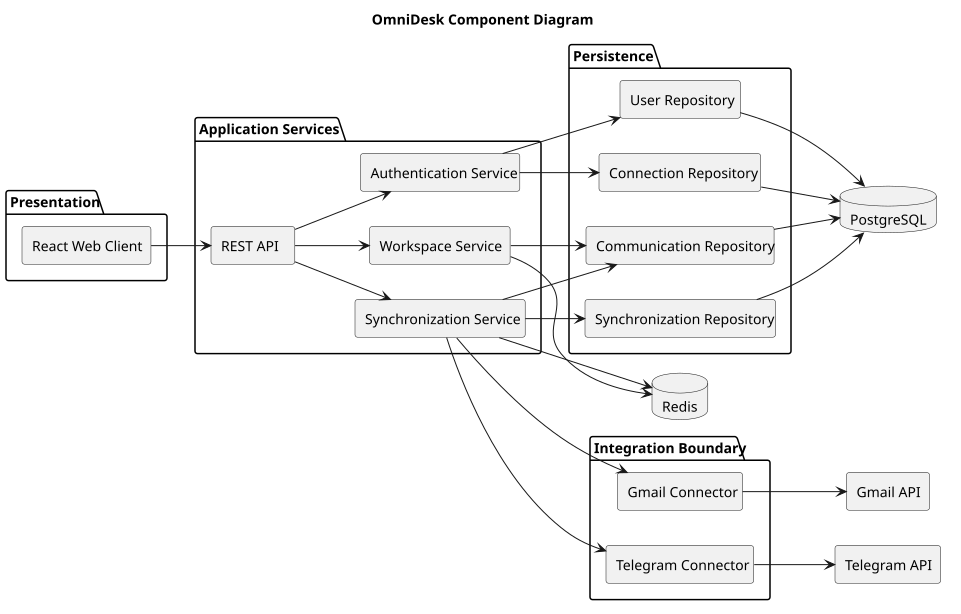

# Component Diagram

> Status: Draft

## Purpose

This diagram shows the main software components of OmniDesk and their dependencies.

## Diagram

## Component Responsibilities

- The React client provides the user interface.

- The REST API exposes application operations.

- Connectors isolate provider-specific integration logic.

- Repositories isolate persistence access.

- PostgreSQL stores durable application data.

- Redis supports caching or background processing where justified.

- External APIs remain outside the OmniDesk boundary.

## Design Rules

- Components should have clear responsibilities.

- Provider-specific logic must remain behind connector interfaces.

- Core business logic should remain independently testable.

- External failures should be isolated where possible.

## PlantUML Source

The editable PlantUML source is available in [component-diagram.puml](./diagrams/component-diagram.puml).
