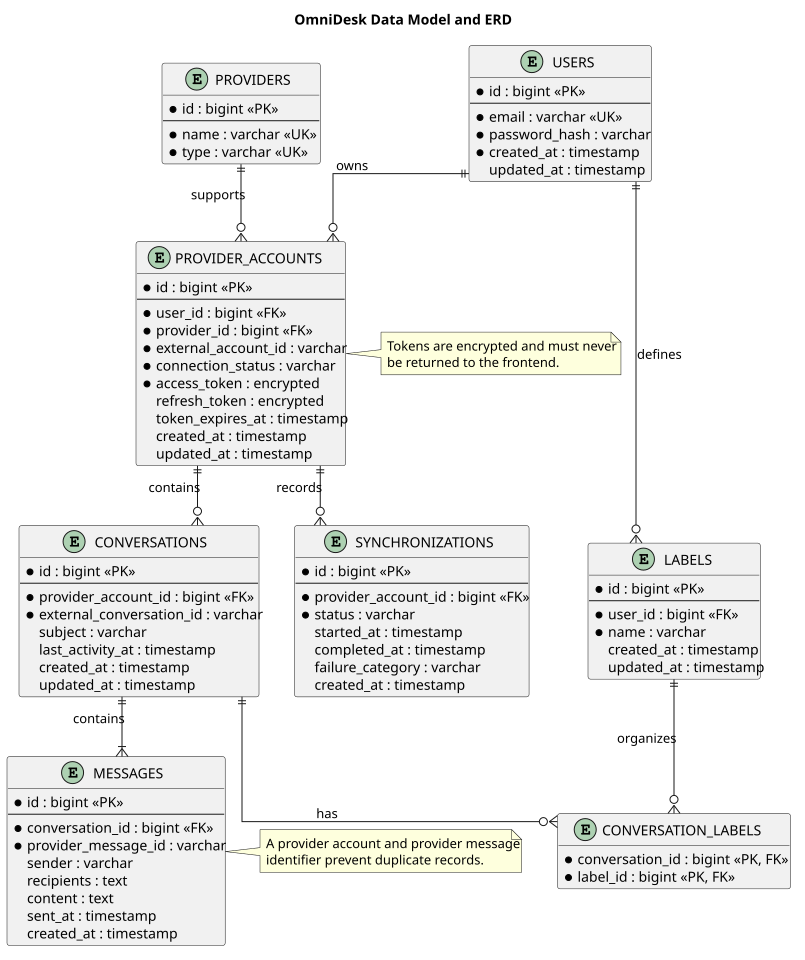

# Data Model and ERD

> Status: Draft

## Purpose

This document defines the conceptual data model for OmniDesk.

It identifies the main entities, relationships, ownership boundaries, and persistence responsibilities without finalizing implementation-specific migrations.

## Design Objectives
- Represent provider-independent communication concepts.
- Preserve provider and external identifiers.
- Support multiple provider accounts per user.
- Prevent duplicate synchronized records.
- Protect credentials and tokens.
- Support local labels and organization.
- Record synchronization activity.
- Enforce user ownership across all protected data.

## Data Model and ERD

## Entity Responsibilities
| Entity | Responsibility |
|---|---|
| Users | Stores OmniDesk user identity and authentication data |
| Providers | Identifies supported external communication providers |
| Provider Accounts | Represents a user's connected provider account |
| Conversations | Represents provider-independent communication threads |
| Messages | Stores synchronized communication content |
| Labels | Stores user-defined local organization metadata |
| Conversation Labels | Associates conversations with local labels |
| Synchronizations | Records synchronization activity and status |

## Ownership Rules
- A user owns their provider accounts.
- A user owns their local labels.
- A provider account belongs to one user.
- Conversations belong to a provider account.
- Messages belong to a conversation.
- Synchronization records belong to a provider account.
- Users must not access entities owned by another user.

## Identifier and Duplicate Rules
- Every entity has an internal identifier.
- Provider accounts preserve the external account identifier.
- Conversations preserve the external conversation identifier.
- Messages preserve the provider message identifier.
- Duplicate prevention must consider the provider account and provider identifier.
- The exact database uniqueness constraints will be finalized during implementation.

## Credential Protection
- Access tokens must be encrypted or otherwise securely protected at rest.
- Refresh tokens must be encrypted or otherwise securely protected at rest.
- Tokens must never be returned to the frontend.
- Tokens must not be written to logs.
- Credentials must be removed or invalidated according to the approved disconnection policy.

## Communication Data

The normalized communication model may contain:
- Sender
- Recipients
- Subject or title
- Message content
- Sent timestamp
- Provider identifier
- External message identifier
- Provider-specific metadata where necessary

Provider-specific fields should not unnecessarily leak into core workspace behavior.

## Synchronization Data

Synchronization records may contain:
- Provider account reference
- Synchronization status
- Start timestamp
- Completion timestamp
- Failure category
- Safe diagnostic information
- Created timestamp

Synchronization records must not contain passwords, tokens, or unnecessary message content.

## Persistence Rules
- PostgreSQL is the durable persistence store.
- Repository boundaries should isolate persistence access.
- Database schema details are not finalized in this conceptual design.
- Redis may support caching or background processing where justified.
- Cached data must not weaken authorization or privacy controls.

## Deletion and Retention

SEC-002 is the authoritative V1 data-classification and lifecycle baseline. The lifecycle model is therefore no longer wholly undecided.

The following implementation/operational values remain unresolved:
- exact retention period for synchronized communication data;
- exact account-deletion workflow and retention exceptions;
- backup retention/expiration timing;
- provider-specific lifecycle details that depend on implementation;
- treatment of locally created labels after related data is deleted.

Current Gmail disconnect behavior removes the authenticated user's local Gmail connection, conversations, and messages while attempting provider-side authorization revocation.

## Security Considerations
- Every protected entity must be associated with an ownership boundary.
- Queries must enforce user ownership.
- External provider data must be treated as untrusted input.
- Sensitive fields must be protected at rest according to the approved control for their data class.
- Database access must be restricted to authorized application services.
- Audit and diagnostic records must avoid sensitive content.

## Persisted Communication Content Protection

Message bodies are classified as Highly Sensitive by SEC-002. The repository does not currently select application-level/field-level encryption or client-side/end-to-end encryption for persisted message bodies.

These protection layers are distinct:

1. **Transport encryption** - protects data in transit and is governed by SEC-014.
2. **Infrastructure/disk/storage encryption** - protects storage media and snapshots according to the production storage baseline under SEC-015.
3. **Database-native encryption** - may be part of the selected production storage model but is not yet finalized.
4. **Application-level/field-level encryption** - is already used for Gmail provider tokens, but is not currently selected for message bodies.
5. **Client-side/end-to-end encryption** - is not part of the approved V1 scope.

SEC-015 owns the unresolved V1 architectural decision for persisted communication-content protection. If application-level message encryption is selected later, SEC-008 owns key-management implications and SEC-016 owns backup/recovery implications.

The decision must consider:

- breach blast radius;
- search and indexing behavior;
- synchronization and duplicate detection;
- application/runtime complexity;
- key rotation and recovery;
- backup and restore behavior.

## Unresolved Decisions
| ID | Decision | Current State |
|---|---|---|
| DATA-001 | Final database schema and migrations | Partially implemented; future schema evolution remains change-controlled |
| DATA-002 | Provider credential encryption/key lifecycle | Gmail access/refresh-token field encryption is implemented; production key lifecycle remains under SEC-008; Telegram session protection remains under SEC-019 |
| DATA-003 | Communication data retention period | SEC-002 lifecycle baseline exists; exact operational duration remains unresolved |
| DATA-004 | Deletion behavior after provider disconnection | SEC-002 baseline exists; Gmail local disconnect cleanup is implemented; remaining provider-specific behavior is pending |
| DATA-005 | Exact provider-specific metadata to preserve | To be finalized during integration implementation/refinement |
| DATA-006 | Exact database uniqueness constraints | Implemented where required by current features; future provider constraints remain change-controlled |
| DATA-008 | Persisted communication-content protection model | Unresolved security architecture decision owned by SEC-015; application-level message encryption and E2EE are not implicitly required |

## PlantUML Source

The editable PlantUML source is available in [data-model-and-erd.puml](./diagrams/data-model-and-erd.puml).

## Relationship to Later Documents

This design will provide input for:
- Database Schema Design
- Laravel Migrations
- Repository Design
- Provider Synchronization Implementation
- Security Implementation
- Privacy and Data Lifecycle Design
- API Implementation
- Integration Testing
