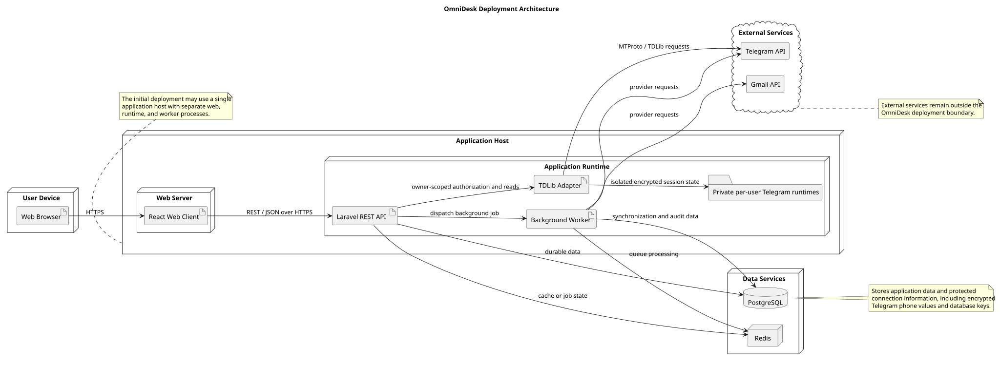

# Deployment Architecture

> Status: Draft

## Purpose

This document defines the initial deployment architecture for OmniDesk.

It describes the runtime nodes, data services, external services, and communication paths required to operate the application.

## Deployment Objectives
- Support the React web client.
- Run the Laravel REST API.
- Store durable application data in PostgreSQL.
- Use Redis for caching or background job processing where justified.
- Protect credentials and provider tokens.
- Keep external services outside the application boundary.
- Allow the initial deployment to remain simple and maintainable.

## Deployment Architecture Diagram

## Deployment Nodes
| Node | Responsibility |
|---|---|
| User Device | Runs the user's web browser |
| Web Server | Serves the React web client |
| Application Runtime | Runs the Laravel REST API |
| Background Worker | Processes synchronization and other asynchronous jobs |
| PostgreSQL | Stores durable application data |
| Redis | Supports caching or background job processing where justified |

## Application Host

The initial deployment may use one application host containing:
- Web server
- React client assets
- Laravel application runtime
- Background worker process

These processes may be separated across different hosts when operational requirements justify it.

## Infrastructure Trust Assumption

The V1 server-side architecture requires the application runtime to process application-readable communication data. The approved production hosting, database/storage, snapshot, and backup operational boundary is therefore a trusted infrastructure boundary.

Authorized infrastructure or platform administrators with sufficiently privileged access may technically be capable of accessing plaintext application data where the application itself must be able to read that data.

Reducing hosting-provider/operator visibility would require a materially different security architecture, such as application-level encryption with separately controlled keys, client-side encryption, confidential computing, or equivalent controls. Those controls are not silently included in V1 and require separate risk/design approval.

This assumption is traced to SEC-001, SEC-008, SEC-015, and SEC-016.

## Data Protection Layers

The deployment distinguishes:

- transport encryption for network paths;
- infrastructure/storage encryption for disks, volumes, managed storage, and snapshots;
- database-native encryption where selected by the production platform;
- application-level/field-level encryption for specifically approved fields such as current Gmail provider tokens;
- client-side/end-to-end encryption, which is not part of the approved V1 scope.

The exact persisted-message protection model remains an unresolved SEC-015 design decision. Backup protection remains governed by SEC-016.

## Data Services

### PostgreSQL

PostgreSQL is the durable persistence service.

It stores:
- User accounts
- Provider connections
- Conversations
- Messages
- Labels
- Synchronization records
- Safe audit information

Provider credentials and tokens must be protected at rest.

### Redis

Redis may be used for:
- Background job queues
- Temporary operation state
- Caching
- Rate-limit support

Redis is optional and must be used only where justified.

Cached data must not bypass authentication or authorization checks.

## External Services

The deployment communicates with:
- Gmail API
- Telegram API

External services remain outside the OmniDesk deployment boundary.

Their availability, policies, rate limits, and capabilities are external dependencies.

## Communication Paths
| Source | Destination | Communication |
|---|---|---|
| Browser | Web Server | HTTPS |
| React Client | Laravel API | REST and JSON over HTTPS |
| Laravel API | PostgreSQL | Durable data access |
| Laravel API | Redis | Cache or job state |
| Laravel API | Background Worker | Background job dispatch |
| Background Worker | PostgreSQL | Synchronization and audit data |
| Background Worker | Gmail API | Provider requests |
| Background Worker | Telegram API | Provider requests |

## Security Requirements
- External client communication must use HTTPS.
- Provider tokens must remain on the backend.
- Database credentials must not be exposed to the frontend.
- External services must not receive unnecessary secrets.
- Internal services must use protected configuration.
- Logs must not contain passwords, tokens, or session secrets.
- Database access must be restricted.
- Redis access must be restricted.
- Background jobs must preserve user ownership boundaries.

## Reliability Requirements

The deployment should:
- Keep existing communication data available during provider failures.
- Allow background jobs to retry temporary failures.
- Isolate failures between providers.
- Monitor worker and queue failures.
- Monitor PostgreSQL and Redis availability.
- Avoid data loss during application restarts.
- Provide safe recovery procedures.

## Scalability Direction

The initial deployment should remain simple.

If demand increases, the following components may scale independently:
- Web server
- Laravel application runtime
- Background workers
- Redis
- PostgreSQL
- Provider integration workload

Scaling decisions should be based on measured requirements.

## Backup and Recovery

The deployment should define:
- PostgreSQL backup frequency
- Backup retention period
- Recovery testing procedure
- Provider credential recovery procedure
- Queue and failed-job recovery procedure
- Data deletion and retention behavior

The exact backup strategy belongs to Deployment Planning.

## Environment Separation

The project should distinguish between:
- Local development
- Testing
- Staging or demonstration
- Production

Environment-specific credentials and configuration must not be committed to the repository.

## Observability

The deployment should monitor:
- API availability
- Application errors
- Background worker status
- Queue depth
- Synchronization failures
- Provider rate-limit responses
- PostgreSQL health
- Redis health
- Resource usage

Monitoring data must not expose sensitive communication content or credentials.

## Unresolved Decisions
| ID | Decision | Current State |
|---|---|---|
| DEP-001 | Exact hosting provider | Unresolved |
| DEP-002 | Whether web and application runtime use separate hosts | To be decided during deployment planning |
| DEP-003 | Production database hosting model | Unresolved |
| DEP-004 | Redis hosting model | Unresolved |
| DEP-005 | Backup frequency and retention | Requires deployment decision |
| DEP-006 | Monitoring and alerting tools | Requires deployment decision |
| DEP-007 | Containerized or direct deployment | To be decided before implementation deployment |
| DEP-008 | Production domain and TLS configuration | To be finalized during deployment planning |

## PlantUML Source

The editable PlantUML source is available in [deployment-architecture-diagram.puml](./diagrams/deployment-architecture-diagram.puml).

## Relationship to Later Documents

This design will provide input for:
- Deployment Planning
- Environment Configuration
- Infrastructure Setup
- Security Operations
- Backup and Recovery
- Monitoring and Observability
- Performance Testing
- Production Release
