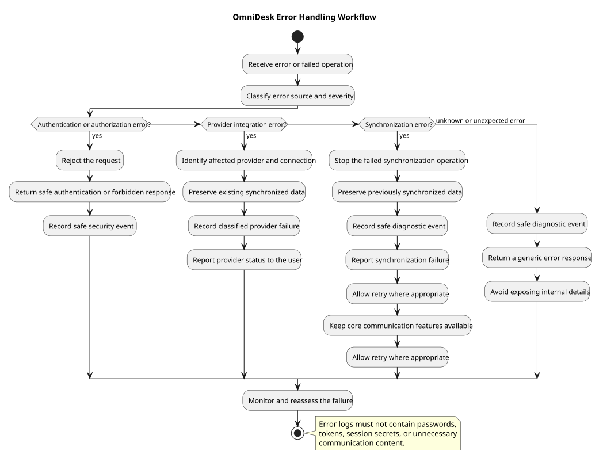

# Error Handling Design

> Status: Draft

## Purpose

This document defines the initial error-handling design for OmniDesk.

The design provides consistent, secure, and user-understandable behavior when application operations fail.

## Design Objectives
- Classify errors consistently.
- Protect sensitive technical information.
- Preserve existing user data during failures.
- Isolate provider-specific failures.
- Provide safe diagnostic information.
- Support retry behavior where appropriate.
- Make failures observable and testable.

## Error Handling Workflow



## Error Categories
| Category | Description | Typical Response |
|---|---|---|
| Authentication Error | User identity cannot be verified | Require authentication |
| Authorization Error | User is not allowed to access a resource | Return forbidden response |
| Validation Error | Input data is invalid | Return validation details |
| Provider Error | External provider request failed | Preserve data and report provider status |
| Synchronization Error | Data synchronization did not complete | Preserve existing data and allow retry |
| Persistence Error | Data could not be stored or retrieved | Return safe error and record diagnostic event |
| Rate Limit Error | Request or provider limit was exceeded | Delay, retry, or report rate-limit status |
| Unexpected Error | Failure does not match a known category | Return generic error and record diagnostic event |

## Error Handling Principles
- Errors must be classified before being reported.
- Users should receive clear and actionable messages.
- Internal implementation details must not be exposed.
- Sensitive information must not appear in responses.
- Sensitive information must not appear in logs.
- Existing synchronized data must be preserved when possible.
- One provider failure must not disable unrelated providers.
- Retry behavior must be controlled and limited.

## Authentication and Authorization Errors

The system should:
- Reject requests without valid authentication.
- Reject expired or invalid sessions.
- Deny access to resources owned by another user.
- Return safe authentication or forbidden responses.
- Avoid revealing whether another user's resource exists.
- Record safe security events.
- Apply rate limiting to repeated failed requests.

## Provider Errors

Provider errors may include:
- Invalid provider credentials.
- Missing provider permissions.
- Provider rate limits.
- Provider service outages.
- Unsupported provider capabilities.
- Invalid provider responses.

The system should:
- Identify the affected provider and connection.
- Preserve previously synchronized data.
- Record a classified provider failure.
- Report provider status to the user.
- Allow other providers to continue operating.
- Retry only when appropriate.

## Synchronization Errors

When synchronization fails:
- The failed operation must stop safely.
- Previously synchronized data must remain available.
- Partial data must not corrupt valid records.
- Duplicate prevention must remain effective.
- A safe diagnostic event must be recorded.
- The failure status must be visible to the user.
- Retry behavior may be offered.

## Persistence Errors

Persistence errors may occur when data cannot be written, updated, or retrieved.

The system should:
- Avoid reporting raw database errors to users.
- Return a safe generic response.
- Preserve data where possible.
- Avoid confirming an operation that was not completed.
- Record diagnostic information without sensitive content.
- Alert maintainers when the error affects reliability.

## API Error Responses

API errors should use a consistent structure:

```json

{

  "error": {

    "code": "SYNCHRONIZATION_FAILED",

    "message": "Synchronization could not be completed.",

    "details": {}

  }

}

```

The `details` object must not contain credentials, tokens, stack traces, or unnecessary communication content.

## Retry Policy

Retries should be used only for temporary failures.

Retryable failures may include:
- Temporary provider unavailability.
- Network timeouts.
- Provider rate limits.
- Temporary persistence unavailability.

Retries should not be used automatically for:
- Invalid credentials.
- Invalid authorization state.
- Invalid request data.
- Forbidden access.
- Unsupported provider capabilities.

Retry behavior must use controlled limits and backoff.

## User-Facing Error Messages

User-facing messages should:
- Explain what happened in plain language.
- Avoid exposing internal implementation details.
- Identify the affected provider where appropriate.
- Explain whether existing data remains available.
- Tell the user whether retrying is possible.
- Avoid exposing security-sensitive information.

## Logging and Diagnostics

The system may record:
- Error category
- Operation type
- Affected provider
- Affected connection identifier
- Request or operation identifier
- Timestamp
- Processing duration
- Retry count
- Safe diagnostic context

Logs must not contain:
- Passwords
- Access tokens
- Refresh tokens
- Session secrets
- Unnecessary message content
- Raw stack traces in user-visible responses

## Failure Isolation

The design must isolate failures between:
- Gmail and Telegram integrations.
- Provider synchronization and local workspace access.
- User-facing responses and internal diagnostics.
- Individual operations and unrelated user sessions.

## Monitoring and Reassessment

The system should monitor:
- Error frequency
- Error categories
- Provider failure rates
- Synchronization failure rates
- Retry frequency
- Rate-limit responses
- Persistence failures
- User-visible error occurrences

Repeated or severe errors must be reassessed and reflected in requirements, design, implementation, or testing.

## Unresolved Decisions
| ID | Decision | Current State |
|---|---|---|
| ERR-001 | Exact retry and backoff limits | To be finalized during implementation |
| ERR-002 | Centralized error-reporting mechanism | To be finalized during implementation |
| ERR-003 | Production alerting thresholds | To be finalized during deployment design |
| ERR-004 | Exact user-facing error messages | To be finalized during UI design |
| ERR-005 | Error retention period | Requires observability and privacy decision |
| ERR-006 | Dead-letter handling for failed background jobs | To be finalized during implementation |
| ERR-007 | Provider-specific retry requirements | Requires provider validation |

## PlantUML Source

The editable PlantUML source is available in [error-handling-workflow-diagram.puml](./diagrams/error-handling-workflow-diagram.puml).

## Relationship to Later Documents

This design will provide input for:
- API Implementation
- Provider Integration
- Synchronization Implementation
- Security Implementation
- Logging and Monitoring
- Integration Testing
- Failure Testing
- Deployment Planning
