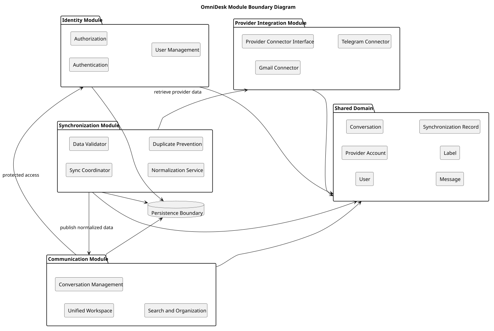

# Module Boundary Diagram

> Status: Draft

## Purpose

This diagram defines the main logical module boundaries of OmniDesk and their dependencies.

## Diagram

## Module Responsibilities

- Identity manages authentication, authorization, and users.

- Communication manages the unified workspace and local organization.

- Synchronization validates, normalizes, and deduplicates provider data.

- Provider Integration isolates Gmail and Telegram logic.

- Shared Domain contains provider-independent business concepts.

- Persistence provides durable storage for application data.

## Design Rules

- Provider-specific logic remains behind the provider integration boundary.

- Core modules use shared domain concepts.

- Persistence details remain behind module boundaries.

- Core business logic should remain independently testable.

## PlantUML Source

The editable PlantUML source is available in [module-boundary-diagram.puml](./diagrams/module-boundary-diagram.puml).
