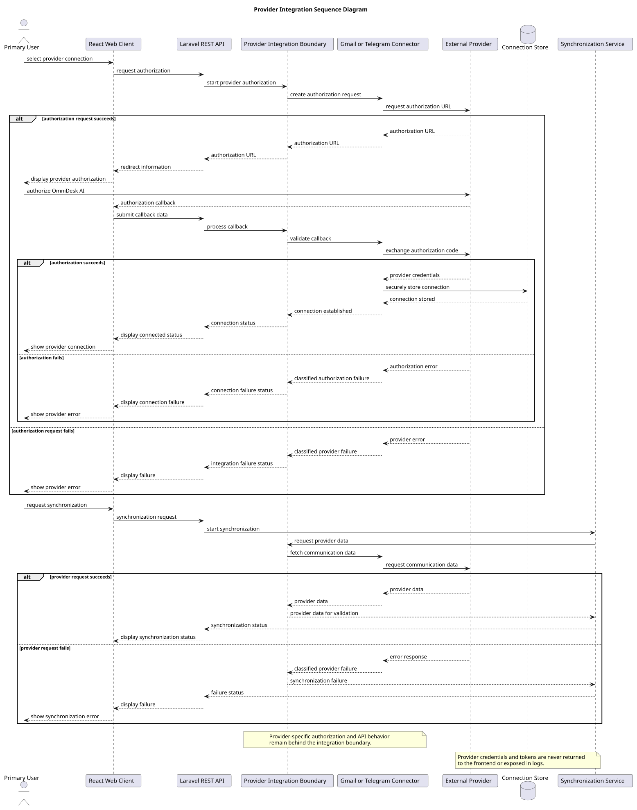

# Provider Integration Design

> Status: Draft

## Purpose

This document defines the initial design for integrating Gmail and Telegram with OmniDesk.

The design isolates provider-specific behavior and exposes provider-independent communication capabilities to the rest of the system.

## Integration Objectives
- Support Gmail and Telegram as the initial providers.
- Isolate provider-specific authorization and API behavior.
- Normalize provider data before it enters the unified workspace.
- Protect provider credentials and tokens.
- Prevent duplicate synchronized records.
- Report provider and synchronization failures clearly.
- Allow future providers to use the same integration boundary.

## Integration Boundary

The Provider Integration Boundary is responsible for:
- Starting provider authorization.
- Processing provider authorization callbacks.
- Validating provider responses.
- Managing provider-specific API requests.
- Retrieving communication data.
- Mapping provider data to internal concepts.
- Classifying provider errors.
- Protecting provider credentials and tokens.

The core application must not depend directly on Gmail or Telegram API details.

## Provider Integration Sequence Diagram

## Supported Providers
| Provider | Initial Scope | Integration Status |
|---|---|---|
| Gmail | Retrieve supported Gmail communication data | Implemented: OAuth, connector, normalization, synchronization, and disconnect/revocation behavior are present in the current repository |
| Telegram | Retrieve supported Telegram communication data | TDLib/MTProto through a persistent per-connection authorization worker; real authorization, retrieval, and refresh recovery validated |

Future providers are outside the current MVP commitment.

## Provider Connector Responsibilities

Each provider connector should implement the common integration behavior required by the application:
- Build authorization requests.
- Validate authorization callbacks.
- Exchange authorization codes where applicable.
- Store connection information securely.
- Retrieve provider communication data.
- Translate provider errors into classified integration failures.
- Return provider-independent data to the synchronization service.

## Normalized Communication Data

Provider data should be mapped to common internal concepts, including:
- Provider account
- Conversation
- Message
- Sender
- Recipient
- Subject or title where available
- Message content
- Timestamp
- Provider identifier
- Provider-specific metadata where required

Provider identifiers must be preserved for traceability and duplicate prevention.

## Authorization Rules
- The user must authenticate with OmniDesk before connecting a provider.
- Provider authorization must use official provider mechanisms.
- Authorization state must be validated during callbacks.
- Provider tokens must remain on the backend.
- Provider tokens must never be returned to the frontend.
- Provider connections must belong to the authenticated user.
- Disconnecting a provider must invalidate its connection where applicable.

## Synchronization Interaction
- Synchronization requests are handled by the Synchronization Service.
- The Synchronization Service uses the Provider Integration Boundary.
- Connectors retrieve data from the relevant provider.
- External data is validated before normalization.
- Normalized records are returned to the Synchronization Service.
- Provider and account identifiers are used for duplicate prevention.
- Provider failures must not corrupt existing local data.

## Error Classification

Provider errors should be classified into meaningful categories:
| Error Category | Meaning |
|---|---|
| Authorization Failure | Provider authorization did not succeed |
| Authentication Failure | Stored provider credentials are invalid |
| Permission Failure | Required provider permission is unavailable |
| Rate Limit | Provider request limit was exceeded |
| Provider Unavailable | Provider service is temporarily unavailable |
| Invalid Provider Data | Provider response is incomplete or malformed |
| Unsupported Capability | Provider does not support the requested operation |
| Unknown Integration Error | Error could not be classified |

## Security Requirements
- Provider credentials and tokens must be protected at rest.
- Secrets must not be exposed in API responses.
- Secrets must not be written to logs.
- External provider data must be treated as untrusted input.
- Provider responses must be validated before processing.
- Provider callback state must be verified.
- Integration endpoints must be rate limited where appropriate.
- Access to provider connections must be authorized by user ownership.

## Failure Isolation

A failure in one provider integration must not disable unrelated providers.

The system should:
- Record the affected provider and connection.
- Preserve previously synchronized data.
- Report the affected provider status.
- Allow other provider integrations to continue.
- Provide retry behavior where appropriate.
- Avoid exposing sensitive diagnostic information.

## Extensibility Rules
- New providers must implement the established connector boundary.
- Core workspace logic must remain provider-independent.
- Provider-specific transformations must remain inside connectors or mapping services.
- Provider-specific errors must be translated into common error categories.
- New providers must not require unrelated core modules to change.
- Provider support must be validated before being added to the MVP scope.

## Current Gmail Security Evidence

The current repository provides the following implemented Gmail controls:

- OAuth client scopes are supplied through `GOOGLE_SCOPES`; the committed default is `openid,email,profile,https://www.googleapis.com/auth/gmail.readonly`.
- access and refresh tokens are stored with Laravel encrypted model casts.
- token fields are hidden from serialization.
- automated tests verify that provider credentials are not stored as plaintext and are not serialized.
- Gmail disconnect attempts provider-side revocation and removes the authenticated user's local Gmail connection and synchronized data.

These implemented controls do not complete SEC-008 or SEC-009. SEC-008 still owns production encryption-key lifecycle and environment separation. SEC-009 still owns the formal least-privilege mapping/review. Telegram session material has different security characteristics and remains gated by SEC-019.

## Unresolved Decisions
| ID | Decision | Current State |
|---|---|---|
| PI-001 | Exact Telegram integration mode | Validated: Telegram API/MTProto through official TDLib behind a persistent adapter worker; PB-023 completed with real runtime evidence |
| PI-002 | Gmail scopes | Current implemented default: `openid`, `email`, `profile`, and `https://www.googleapis.com/auth/gmail.readonly`; formal feature-to-scope least-privilege review remains pending under SEC-009 |
| PI-003 | Exact Telegram permissions | User-account client authorization through TDLib; exact production session/security controls finalized by SEC-019 |
| PI-004 | Provider credential protection | Gmail access/refresh-token encryption is implemented with Laravel encrypted model casts and hidden serialization; production key lifecycle remains under SEC-008; Telegram credential/session protection remains under SEC-019 |
| PI-005 | Supported provider message types | To be finalized during implementation |
| PI-006 | Provider pagination and rate-limit strategy | To be finalized during implementation |
| PI-007 | Local data deletion after disconnection | SEC-002 now provides the authoritative lifecycle baseline; Gmail local cleanup is implemented; remaining provider/account lifecycle implementation and exact retention rules remain pending |

## PlantUML Source

The editable PlantUML source is available in [provider-integration-sequence-diagram.puml](./diagrams/provider-integration-sequence-diagram.puml).

## Relationship to Later Documents

This design will provide input for:
- Synchronization Implementation
- Provider Connector Implementation
- Data Model Design
- Error Handling Design
- Security Implementation
- API Implementation
- Integration Testing
- Deployment Planning
