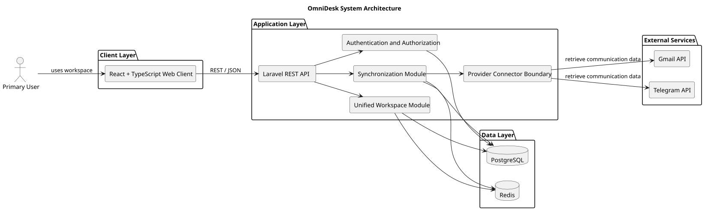

# System Architecture Diagram

> Status: Draft

## Purpose

This diagram presents the initial technical architecture of OmniDesk.

It shows the client, application, data, and external service layers.

## Diagram

## Architecture Layers

- Client Layer: React and TypeScript web client.

- Application Layer: Laravel REST API and core application modules.

- Data Layer: PostgreSQL and Redis.

## Design Rules

- Provider-specific logic remains behind the connector boundary.

- The core workspace uses provider-independent communication concepts.

- Secrets and provider credentials remain protected on the backend.

- Redis is used only where caching or background processing is justified.

## PlantUML Source

The editable PlantUML source is available in [system-architecture-diagram.puml](./diagrams/system-architecture-diagram.puml).
