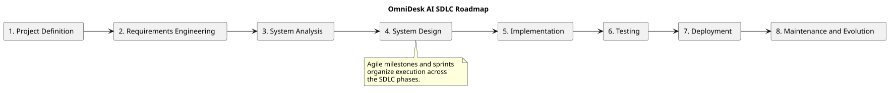

# SDLC Roadmap

> Status: Draft

## Purpose

This document describes the Software Development Life Cycle structure used by OmniDesk AI.

## Roadmap

## SDLC Phases

| Phase | Main Responsibility |

|---|---|

| Project Definition | Define the problem, goals, scope, stakeholders, and constraints |

| Requirements Engineering | Elicit, document, validate, and manage requirements |

| System Analysis | Analyze behavior, domain concepts, workflows, and business rules |

| System Design | Define architecture, modules, APIs, data, security, and deployment structure |

| Implementation | Build the backend, frontend, integrations, and supporting components |

| Testing | Verify functionality, security, reliability, performance, and quality |

| Deployment | Prepare and operate the application in its target environment |

| Maintenance and Evolution | Correct defects, improve the system, and evolve capabilities |

## Agile Execution

Agile milestones and sprints organize the practical execution of the SDLC.

- Milestones represent meaningful outcomes.

- Sprints are short execution cycles.

- Backlog items are selected for sprints.

- Sprint increments are reviewed against acceptance criteria.

- Releases are created after release criteria are satisfied.

## Current Project Structure

The current project uses these SDLC documentation folders:

- `01-project-definition`

- `02-requirements-engineering`

- `03-system-analysis`

- `04-system-design`

- `05-implementation`

The following phases will be documented later:

- Testing

- Deployment

- Maintenance and Evolution

## PlantUML Source

The editable source is available in [sdlc-roadmap.puml](./diagrams/sdlc-roadmap.puml).
