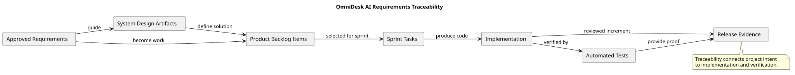

# Requirements Traceability

> Status: Draft

## Purpose

This document describes how OmniDesk AI maintains traceability from approved requirements to design, implementation, testing, and release evidence.

## Traceability Diagram

## Traceability Chain

| Source | Leads To | Purpose |

|---|---|---|

| Approved Requirements | System Design Artifacts | Define the technical response |

| Approved Requirements | Product Backlog Items | Convert needs into planned work |

| System Design Artifacts | Product Backlog Items | Define implementation boundaries |

| Product Backlog Items | Sprint Tasks | Select work for execution |

| Sprint Tasks | Implementation | Produce the software change |

| Implementation | Automated Tests | Verify behavior and quality |

| Automated Tests | Release Evidence | Demonstrate completion |

| Implementation | Release Evidence | Provide the reviewed increment |

## Traceability Expectations

Each selected backlog item should identify:

- The related requirement.

- The related milestone.

- The related sprint.

- The relevant design artifact.

- The implementation tasks.

- The acceptance criteria.

- The relevant automated tests.

- The completion evidence.

## Completion Rule

Work is not considered complete only because code exists.

Completion requires the applicable requirements, acceptance criteria, tests, security checks, and review evidence.

## PlantUML Source

The editable source is available in [traceability.puml](./diagrams/traceability.puml).
